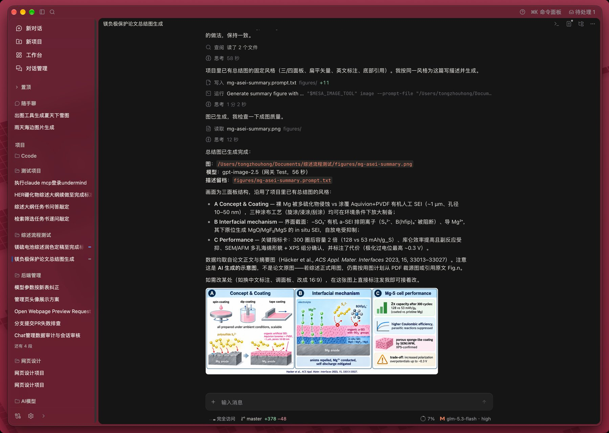
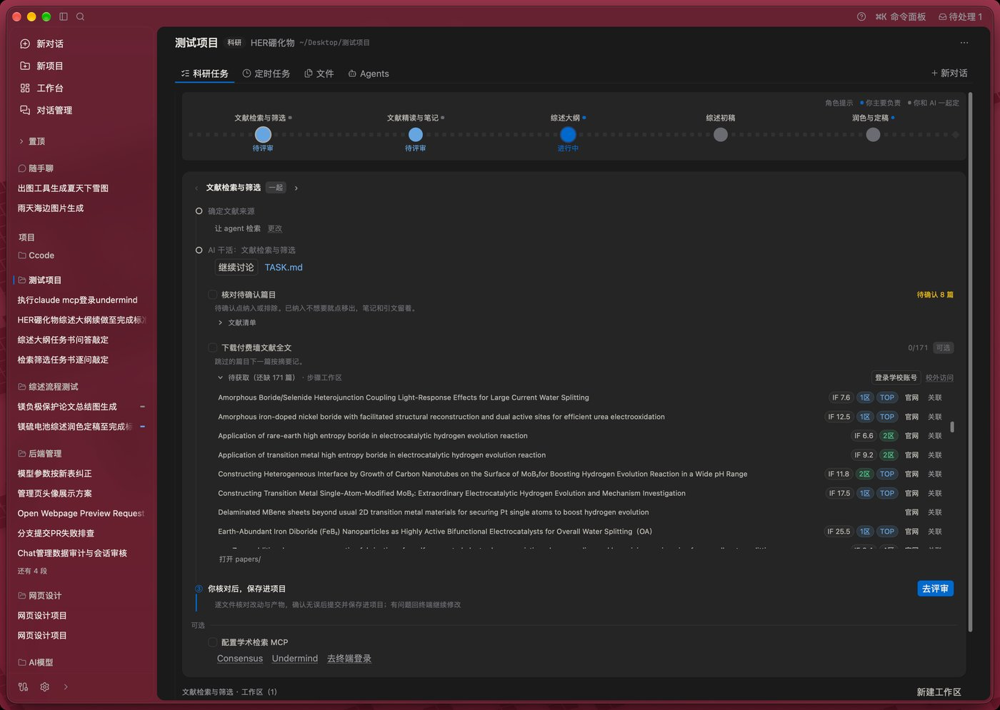
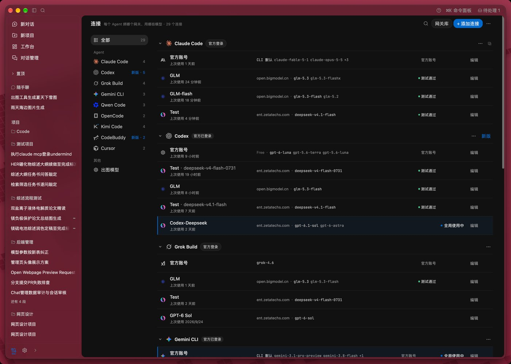
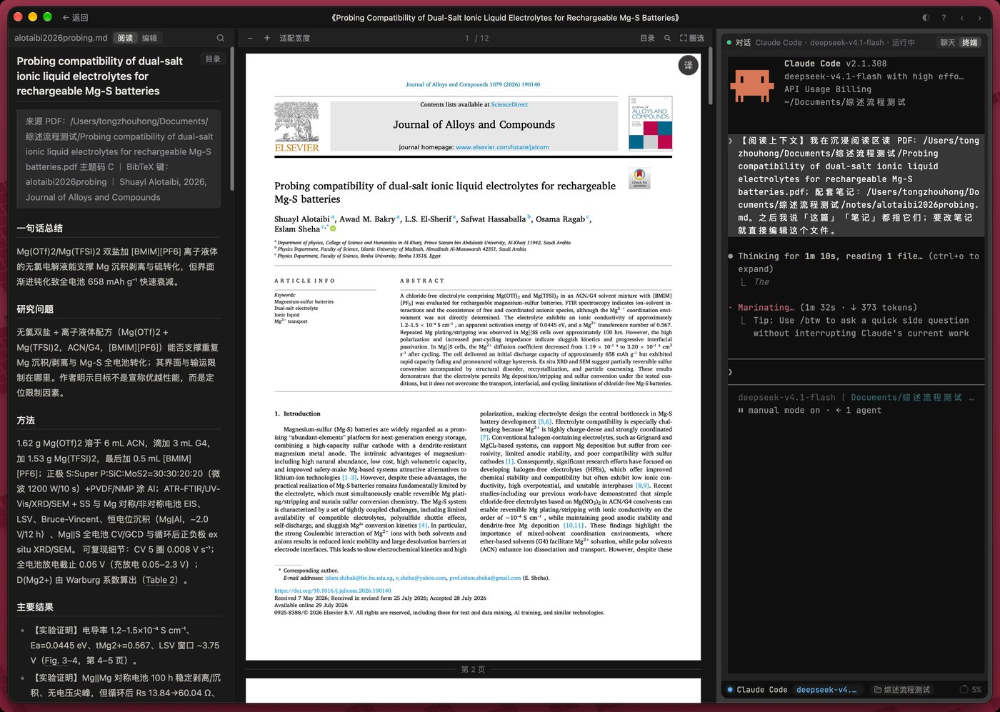
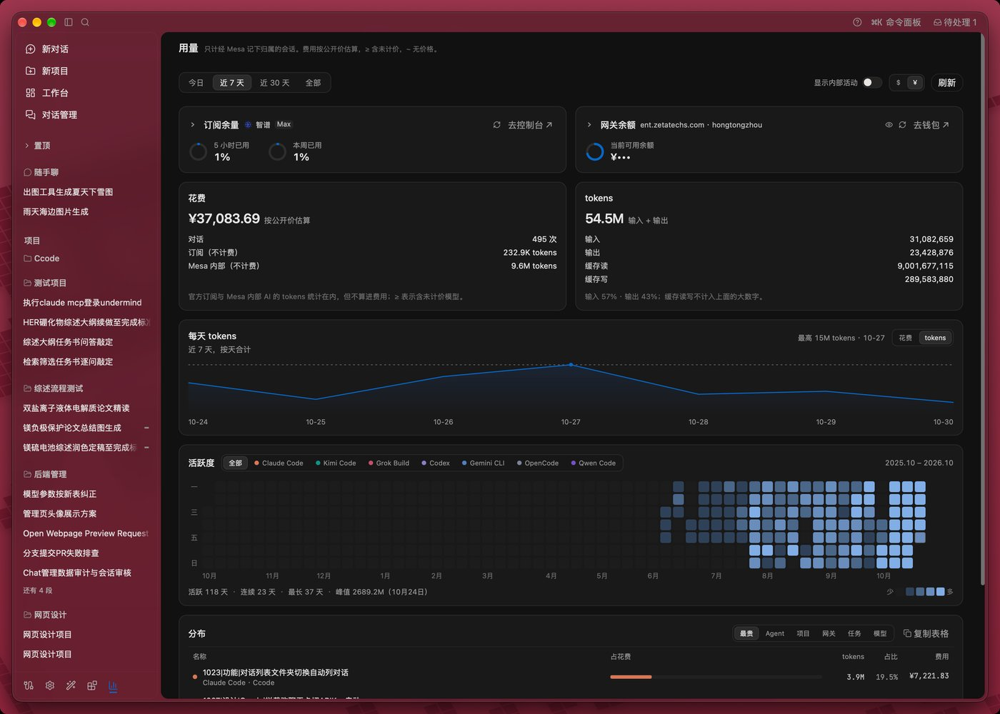

<div align="center">


# Mesa

**An open-source AI research workbench for graduate students and researchers. The AI does the work, Mesa manages and checks it, you make the calls.**

Read papers → clean data → make figures → write the manuscript. Each step runs in an isolated working copy and reaches your project only after you review it; citations must be traceable, and data is never made up.
Under the hood Mesa drives coding agents such as Claude Code and Codex (the onboarding wizard installs them for you) and manages connections, chats and terminals for nine of them.

<p>
  <a href="https://github.com/Zeta-Techs/mesa/actions/workflows/build.yml"></a>
  <a href="https://github.com/Zeta-Techs/mesa/releases/latest"></a>
  
  <a href="LICENSE"></a>
</p>

<p>
  <a href="../../releases/latest"><b>Download</b></a> ·
  <a href="README.md"><b>中文</b></a> ·
  <a href="CHANGELOG.md"><b>Changelog</b></a>
</p>

</div>

https://github.com/user-attachments/assets/a9a7d744-3622-4427-805e-273a89e9326a

<p align="center"><sub>60 seconds: from a pile of PDFs to an English review, with every citation traceable (on-screen text is in Chinese)</sub></p>

<p align="center"></p>

> The app UI and the full documentation are in Chinese. This page is a short English overview.

## Why Mesa

- **A whole research pipeline, no prompt engineering.** Six templates: literature review, research paper, data analysis, thesis, submission & revision, and LaTeX typesetting. Every step comes with a written brief and acceptance criteria, and starts with the previous step's outputs, the project's settled decisions and your personal research profile. Experiments can be computational or wet-lab: for lab work you run the experiment, and the AI handles the protocol, processing rules and data QC.
- **Every claim traces back to a source.** Searches are logged, reference records are generated by script from the search results, and citations may only use keys already in your library. Checks come back as pass, blocked or needs your judgement; checks that require reading the content never pass automatically. You can ask a second AI vendor to cross-check quotes.
- **The AI works, you decide.** Each step runs in an isolated working copy; you review the changes, untick what you don't want, and only then merge. Decisions waiting on you are collected on the workbench as one-click choices; a supervisor's Word comments become a checklist; the project assistant answers "where are we, why did this fail, what's next".

| | Using AI on your own (web chat or terminal) | With Mesa |
|---|---|---|
| Where references come from | The AI lists them from memory, often made up | Logged web search, records generated by script, DOIs resolvable |
| Citations in the text | You check each one | Only keys already in your library, checked one by one |
| What the AI changed | Edits land in your files directly | Edits land in an isolated copy, merged after review |
| Picking up the next step | Re-explain the background every time | The brief carries earlier outputs, settled decisions and your profile |
| Supervisor comments | Copy them over by hand | Word comments become a checklist that flows back into the steps |

**Also a handy agent console**: one set of connections for Claude Code, Codex, Gemini CLI, Qwen Code, OpenCode, Kimi Code, CodeBuddy Code, Cursor CLI, Grok Build and Antigravity CLI (injected at launch by default, each CLI's own config left alone); chat and the real terminal are the same session (`⌘⇧T`); local sessions of all ten are searchable and resumable; costs are summed by project and model.

<table>
  <tr>
    <td width="50%"><br/><sub>Research pipeline: stepper, current step, review before merge</sub></td>
    <td width="50%"><br/><sub>Connections: API keys and official accounts for ten agents</sub></td>
  </tr>
  <tr>
    <td><br/><sub>Reader: notes · PDF · terminal</sub></td>
    <td><br/><sub>Usage: plan quota, gateway balance, cost and activity</sub></td>
  </tr>
</table>

## Features

**Research (the main line)**

- **Pipelines**: six templates with one-click steps; each step works in an isolated copy and merges after review; later steps can send work back to earlier ones for another pass. Research projects without a pipeline use reviewed "goals".
- **Research extras**: scheduled literature radar, journal metric badges, citation checks, verification and research records, a cross-project research profile, EndNote and Zotero bridges.
- **Onboarding**: a first-run wizard installs an agent, connects an account or API key, and creates a first project.

**Under the hood: agent console**

- **Connections**: gateway × binding model, API keys and official accounts side by side, keys stored locally with 0600 permissions and never echoed, a bundled model capability database, one-click CLI install and update.
- **Run page**: chat layer on top of a real xterm.js terminal; file tree, change panel, Monaco preview and editing; inline preview of PDF, docx, pptx, spreadsheets, images, Jupyter notebooks, audio and video; a three-pane reader (notes | PDF | terminal).
- **Sessions**: parses the local session files of all ten CLIs, including ones started outside Mesa; auto titles, archive, Markdown export, session bundles for moving machines.
- **Coding and general projects**: coding projects use separate worktrees that merge back or open a PR.
- **Skills & MCP**: one skill library distributed to every CLI, 22 built-in skills; one MCP list, with presets for Consensus, Undermind and Blender.

## Install

Download from [Releases](../../releases):

| Platform | File |
|---|---|
| macOS, Apple silicon | `Mesa_x.x.x_aarch64.dmg` |
| macOS, Intel | `Mesa_x.x.x_x64.dmg` |
| Windows | `Mesa_x.x.x_x64-setup.exe` (silent install: `setup.exe /S`) |

No Linux build yet. The macOS build is not notarized yet; if macOS says the app is damaged, run `xattr -cr /Applications/Mesa.app`. The Windows installer is not code-signed yet; on the SmartScreen prompt choose **More info → Run anyway**.

## Development

```bash
npm install
npm run tauri:dev      # dev window "Mesa Dev - 热更新", HMR + Rust auto-restart
npm test
cd src-tauri && cargo test
```

See [CONTRIBUTING.md](CONTRIBUTING.md) and [AGENTS.md](AGENTS.md) (Chinese). Security reports: [SECURITY.md](SECURITY.md).

## License & trademarks

[Apache-2.0](LICENSE), with [NOTICE](NOTICE). The license does not grant trademark rights: the "Mesa" name and icon belong to the maintainers. Redistributed modified versions must use a different name and icon; see [TRADEMARKS.md](TRADEMARKS.md). Mesa is not an official product of Claude Code, Codex or any other CLI, and is unrelated to the [Mesa 3D graphics library](https://mesa3d.org/).

Copyright 2026 泽塔前沿科技（杭州）有限公司
