# Mesa 使用教程

这份教程按「第一次打开 → 连接 AI → 建课题 → 完成一篇综述 → 日常使用与维护」的顺序写，可以从头跟着做，也可以按目录跳读。科研项目里的 **英文综述流程** 是重点（其他科研流程的逐步说明后续补充），每一步都写清你要做什么、AI 做什么、会产出什么、怎样算做完。

按钮的逐项说明、细节行为见 [产品说明书](user-guide.md)；文中常用词的统一含义见说明书 [14.1 常用词对照](user-guide.md#141-常用词对照)；版本改动见 [CHANGELOG.md](../../CHANGELOG.md)。

文中 **粗体** 是界面上的原文，方便你对着屏幕找；个别界面词不够直白时，第一次出现会在括号里用白话解释。

---

## 目录

1. [Mesa 是什么](#1-mesa-是什么)
2. [安装与第一次打开](#2-安装与第一次打开)
3. [第一次使用：五步完成初始设置](#3-第一次使用五步完成初始设置)
4. [认识 Mesa 的主要页面](#4-认识-mesa-的主要页面)
5. [连接 AI](#5-连接-ai)
6. [建课题：项目与工作方式](#6-建课题项目与工作方式)
7. [★ 科研项目：英文综述流程全程](#7-科研项目英文综述流程全程)
8. [其他科研模板与不使用流程](#8-其他科研模板与不使用流程)
9. [文献雷达：自动追踪新文献](#9-文献雷达自动追踪新文献)
10. [运行页与历史对话](#10-运行页与历史对话)
    - [10.3 换一家 Agent 接着做](#103-换一家-agent-接着做)
11. [「工作」项目与编程项目](#11-工作项目与编程项目)
12. [技能与 MCP](#12-技能与-mcp)
13. [用量、外观与设置](#13-用量外观与设置)
14. [常见问题与故障排查](#14-常见问题与故障排查)

---

## 1. Mesa 是什么

Mesa 是装在电脑上的 **AI （科研）工作台**。它自己不是一个大模型，而是把你电脑上的命令行 AI 工具（**Claude Code、Codex、Gemini CLI、Qwen Code、OpenCode、Kimi Code、CodeBuddy Code、Cursor CLI、Grok Build**，下文统称 **Agent**）管理起来，围绕一个项目文件夹工作。

科研项目最常见的用法：建一个课题，让 AI 检索筛选文献、逐篇精读、写出英文综述；每一步的正式成果先做在工作副本里，你审核通过后才保存到项目。它管三样东西：

- **项目**：一个课题对应一个项目文件夹，PDF、笔记、草稿都归在里面。
- **连接与步骤**：记住用哪个 Agent、哪把密钥、课题进行到了哪一步。
- **工作副本与审核**：AI 做出来的正式成果先放在工作副本里，你审核通过、点了保存，才进入项目文件夹。

### 先认几个词

| 词 | 意思 |
|---|---|
| 项目 / 课题 | 项目是 Mesa 管理工作的基本单位；科研项目在文中也叫课题，两者指同一样东西 |
| 项目文件夹 | 项目在电脑上实际存放文件的文件夹 |
| Agent | 真正执行任务的 AI 工具，例如 Claude Code、Codex；它调用的「模型」才是负责理解和生成内容的大模型 |
| 连接 | 让某个 Agent 用哪个服务地址、哪把密钥、哪些模型的一组设置 |
| 步骤 / 任务书 | 研究流程里的一个阶段；每一步都有一份任务书（`TASK.md`），写明这一步的目标、输入、要求和完成标准 |
| 工作副本 | AI 处理正式成果的独立空间，和项目文件夹隔开 |
| 审核 / 保存到项目 | 你检查工作副本里的成果（界面上叫「评审」）；认可后点保存，成果才写进项目文件夹 |
| 运行 / 对话 | 运行是 AI 的一次执行过程；对话是你和 AI 的交流内容，保存下来就是历史会话 |

完整对照表见说明书 [14.1](user-guide.md#141-常用词对照)。

### 三方分工

| 谁 | 负责 | 不负责 |
|---|---|---|
| 你 | 定课题、决定纳入哪些文献、登录学校账号、决定哪一版作为正式成果 | 手填环境变量、盯着终端每一行日志 |
| Mesa | 准备环境、建工作副本、记住步骤进度、将获取的文献 PDF 保存到 `papers/` 文件夹、未经你审核不把成果保存到项目 | 替你登录学校、存机构密码、把「文件写完」当成「研究成立」 |
| AI | 检索、写笔记、改文件、出草稿 | 自己点保存到项目、批量去出版商网站下 PDF |

### Mesa 不做的事

- 不是网页聊天框。真正执行任务的是你电脑上的 Agent 程序。
- 不会替你把大课题拆成子任务，也不会替你选用哪个 Agent（Agent 和模型的搭配由你决定）。

### 几条贯穿全书的规则

- **课题有专属空间。** 对话、步骤、文件、定时任务都归在课题的项目文件夹下。
- **正式成果先审核。** 要进课题的正式成果在工作副本里做，你审核通过后才保存到项目。临时提问用「＋新对话」，它直接在项目文件夹里工作。
- **PDF 是原始资料。** 下载或关联的文献直接进 `papers/`；AI 做的表、图、稿件要审核后才进入项目文件夹。
- **密钥按需使用。** 界面只显示密钥尾号；默认只在 Mesa 启动的 AI 运行中提供密钥，不修改电脑上的全局 CLI 配置；同一个 Agent 可以使用来自不同网关的不同模型。

界面叫 Mesa，但数据文件夹仍叫 `ccode`（课题里的 `.ccode/`，家目录下的 `~/ccode/`）。备份或换电脑时按这个名字找。

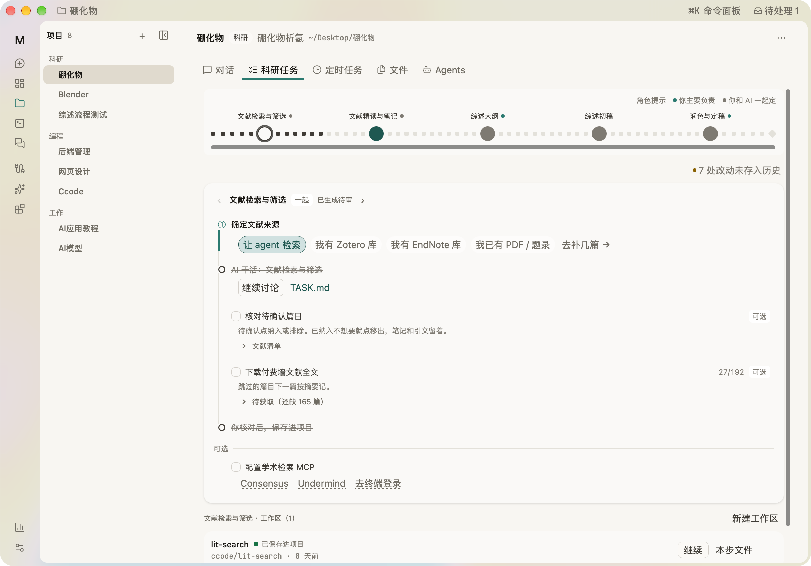

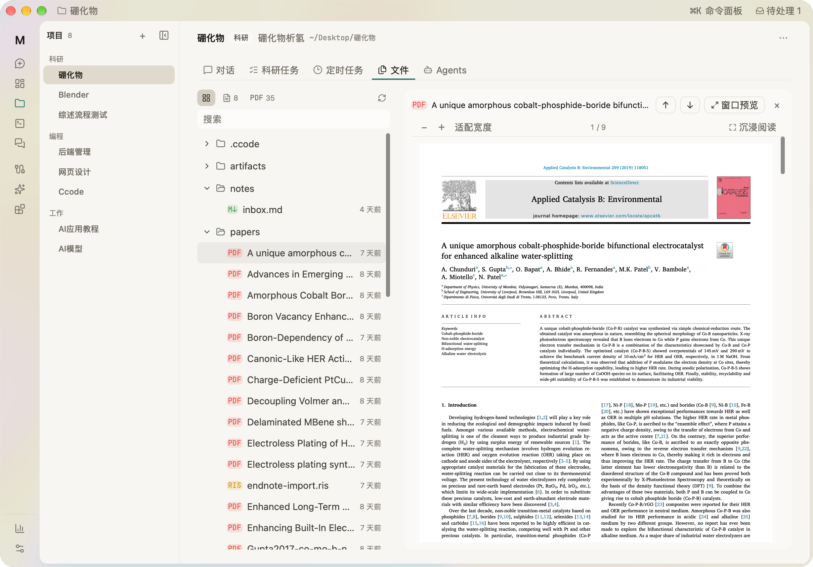

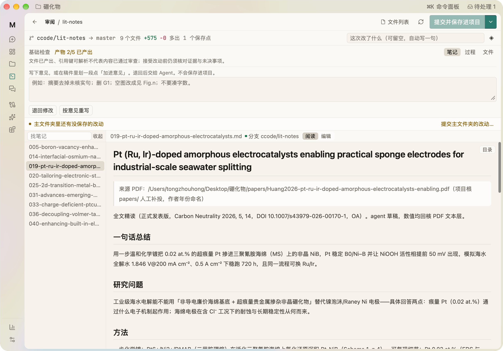

---

## 2. 安装与第一次打开

### 2.1 下载哪个包

到 [Releases](https://github.com/hongtongzhou-design/ccode/releases/latest) 按电脑选：

| 电脑 | 安装包 |
|---|---|
| Mac（M1–M4 芯片） | `Mesa_x.x.x_aarch64.dmg` |
| Windows | `Mesa_x.x.x_x64-setup.exe`（批量部署静默安装：`setup.exe /S`；不再提供 `.msi`） |

本版本不发布 Linux 安装包。

带 `.sig`、`latest.json` 的是自动更新用的签名文件，不用下。

Intel 芯片 Mac 本版本不出包（上面的 aarch64 包装不上）。Windows ARM 机器可以用 x64 包靠系统自带的模拟运行，但没有测试过，不保证。

### 2.2 Mac 提示「已损坏，无法打开」

文件没坏，是应用还没做苹果公证。打开「终端」执行：

```bash
xattr -cr /Applications/Mesa.app
```

每次重新下载安装都要做一次。

### 2.3 打开之后

默认停在 **工作台**。左边一列（侧栏）从上到下：**Mesa** 字标（点击展开 / 收起）、工作入口（**工作台**、**新对话**（按钮，不是页面）、**搜对话**）、**项目**（最上面是 **随手聊**，往下每个课题一节：课题名前面一个文件夹图标，下面挂着它的对话）、资源与管理（**连接 / 技能 / MCP / 用量 / 设置**）。`⌘1`–`⌘8`（Windows 用 `Ctrl`）切换八个页面，顺序和侧栏从上到下一样（工作台、搜对话、项目、连接…；运行页没有编号，回到对话点侧栏里那一段）；`⌘N` 开新对话，`⌘K` 打开命令面板。

还没有课题时，工作台中间写着 **从一个项目开始**，有一个 **添加项目** 按钮。三条路都可以：

1. 只想试 AI 会不会说话：点侧栏 **新对话**（工作台下面那一项，或按 `⌘N`；不建课题）。
2. 有课题文件夹：点 **添加项目**，或侧栏「项目」旁的 **＋ → 添加已有文件夹…**。
3. 想先摸科研界面：侧栏「项目」旁的 **＋ → 创建示例课题**。

窗口顶上的 **待处理** 带数字时，说明有事需要你确认或处理；没数字就是没有待办。

**怎样算装好：** 能看到工作台，侧栏里的入口都能点进去。

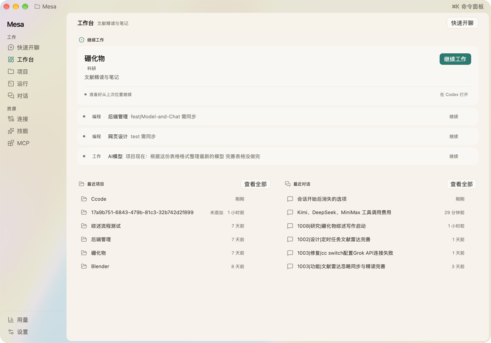

### 2.4 新对话（不建课题）

1. 点 **新对话**（或按 `⌘N`），直接进入 **运行** 页的一段空白对话，不弹窗；侧栏 **随手聊** 下面最上面多一行 **新对话**。文件夹默认 `~/ccode/scratch`（随手聊）；想让对话归到哪个项目，发第一句之前点输入框下面左边的项目按钮换好——发出第一句后目录就定了，对话一直跟着它走，事后换不了。
2. 要换 AI、连接、模型、思考档，点输入框下面右边的模型芯片；默认是你上次从这里开对话时用的那套。打字发送，AI 这时才启动。再点 **新对话**，有还没说过话的空白对话就切回那段，聊过的不复用。
3. 聊出有用的东西：点右上角 **>_** 切到终端，终端底下那一行右边的 **⋯ → 转为项目…**，点 **登记** 确认，把开聊的那个文件夹登记成项目，对话自动归到它名下。

写综述、下文献、要留存的成稿不要在这里做，它们需要一个课题。

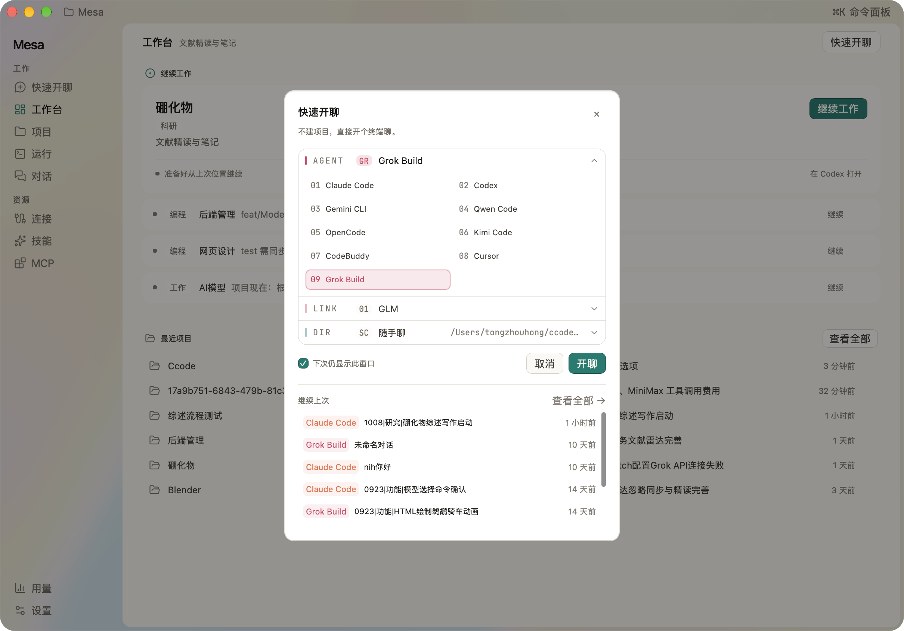

---

## 3. 第一次使用：五步完成初始设置

第一次打开 Mesa 会弹出 **欢迎使用 Mesa**，左侧栏随后多一行 **上手引导**：按「装一个 Agent → 新建网关 → 添加连接 → 开一段新对话 → 切到终端看看 → 认识对话标题 → 建第一个项目」带你走，每一步做完自动打勾，右下角提示下一步（详见说明书 [1.8](user-guide.md#18-上手引导第一次打开先做什么)）。下面五步是更完整的版本，多了科研要用的本机环境和课题默认 AI。

### 第 1 步　补齐本机环境

**设置 → 诊断**。

| 项 | 用途 | 缺了怎么办 |
|---|---|---|
| Git | 科研、编程都要用（工作副本、历史） | 行内 **一键安装** |
| Node.js | 很多 Agent 靠它安装 | 行内 **一键安装** |
| Quarto | 把稿件渲染成 PDF / Word | 一键安装（Homebrew / winget） |
| TeX | 渲染 PDF | 一键装 tectonic；已有 xelatex 就是 ✓ |
| PyMuPDF、Pillow | 从论文 PDF 裁图、拼 panel | 一键用本机 Python 的 pip 装 |

写综述的话，这五行都要是 ✓。Mac 走 Homebrew，Windows 走 winget；Linux 页面会给出 `sudo apt install …` 一类命令。装完点 **重新检测**。

Mac 没装 Homebrew 时：Git 这一行会弹出系统的 Xcode 命令行工具安装窗口，装完点 **重新检测**。Quarto 去 [quarto.org](https://quarto.org/docs/download/) 下安装包，TeX 装 tectonic 或 MacTeX。装好后再点 **重新检测**。没有 Homebrew 时，这两项没有一键安装。

### 第 2 步　让一个 Agent 能用

**连接** → 在某个 Agent 卡片点 **安装**（没装过的话）→ **＋ 添加连接** → 在 **端点预设** 里选服务商 → 贴 API Key → **验证并获取** → 保存。详见第 5 章。

**怎样算做成：** 卡片里出现这条连接，密钥只显示尾号，没有红字。

### 第 3 步　建一个课题

侧栏「项目」旁的 **＋ → 添加已有文件夹…** → 选文件夹 → 填项目名 → 工作方式选 **科研** → **添加** → 选模板（写综述选 **英文综述**）。还没有文件夹就选 **新建项目…**：填名字、选位置，Mesa 替你建好文件夹。建好后课题出现在侧栏「项目」下面。详见第 6、7 章。

### 第 4 步　指定课题默认的 AI

打开课题，切到 **Agents** 页签（6.2 节四个页签之一）→ 在配好的那个 Agent 上点 **设为默认**；点开连接名可选这个课题用哪个模型。只影响这个课题。

**怎样算做成：** 卡片上写着「项目默认」。

### 第 5 步　发出第一句话

- 临时提问、改个错字：在这个课题里开 **新对话**——侧栏课题名那一行悬停出来的 **＋**，或项目页页签行右边的 **新对话**（直接在项目文件夹里工作，第一句前面自动附上项目说明）。
- 出一版要留存的成果：在步骤上点 **开始**（AI 在工作副本里做，你审核后再保存到项目）。


---

## 4. 认识 Mesa 的主要页面

| 分组 | 页面 | 用途 |
|---|---|---|
| 工作 | **工作台** | 打开 Mesa 的首页。看哪些 AI 正在运行（**继续工作** 回到之前关掉的运行）、哪些事等你处理（**待你处理 / 待你验收**）、最近的项目和对话 |
| | **运行** | 和 AI 说话、看它干活的地方，一次摆一段对话（或一个终端）。顶上不再有一排标签：切换对话在侧栏，点课题下面的哪段就打开哪段（所以展开的侧栏里没有「运行」这一行，侧栏收成图标或完全隐藏时，停在图标栏空白处 / 贴窗口左边缘，或按 `⌘0`，项目树会探出来；完全隐藏时顶部岛上也能直接切对话）。**聊天和终端是同一段对话的两种呈现**，右上角 **>_** 随时切换——一边是整理好的对话记录，一边是 AI 实际执行的命令 |
| | **搜对话** | 打开对话页，光标直接在搜索框里：九个 Agent 的历史会话集中查看（Mesa 直接读取它们保存在本机的会话文件），可按课题、按 Agent 筛选回放；自动起标题（设置里可关）、可打包成会话包迁移到另一台电脑、可交给 Codex 客户端 / Claude 桌面版接着聊。日常找对话用侧栏就够，跨课题找、归档、导出来这里 |
| 项目 | **项目** | 每个课题的主页，点侧栏里的课题名进来。项目列表从各 Agent 的历史会话**自动汇总**出来，不用手动建档；一个课题对应一个项目文件夹，对话、步骤、文件、定时任务都归在它名下。课题收着时，名字那一行行尾的小光标说明里面有 AI 开着：琥珀色 = 等你确认，灰色一明一暗 = 在干活 |
| 资源与管理 | **连接** | 九个 Agent 的连接设置：选服务商预设即可填好地址；同一把密钥可同时用于多个 Agent；**验证并获取** 会真实发一次请求、取回可用模型列表；密钥默认只在 Mesa 启动的运行中提供，不修改系统级 CLI 配置（除非你主动点 **设为全局默认**，见 5.5） |
| | **技能** | 给 AI 的科研规范说明：lit-search、review-writing 等内置技能规定了保留检索记录、八段笔记、引用与参考文献一一对应等要求，随流程步骤**自动带上**；也能从 GitHub / ZIP 导入自己的技能，分发到各 Agent |
| | **MCP** | 接入外部工具。Consensus / Undermind 有预设，点一下即可配好学术检索；Blender、Origin 用得上时再配置 |
| | **用量** | 按每次运行记录费用，并归到对应课题名下，而不是只有一笔全局总数；订阅余量、网关余额一起看 |
| | **设置** | 主题、终端、出网代理与学校图书馆、更新都在这里；**诊断** 能一键补齐 Git / Quarto / TeX 等科研依赖 |

侧栏工作入口里（**工作台** 下面）还有一个 **新对话**（不是页面，是个按钮，快捷键 `⌘N`）：不建课题直接开一段空白对话，见 2.4。

**待处理**（窗口顶上）汇总需要你处理的事：命令等你确认、步骤成果可以保存、有修改冲突、Mesa 有新版、Agent 需要你补充信息（例如某篇下不到）、环境缺依赖或连接失效；文献新命中这类通知也在里面，可以一键「全部已读」收起。AI 说完一轮等你下一句，不会进这里。

---

## 5. 连接 AI

没有连接，后面所有「开始」「问 AI」都无法运行。目标只有一个：**至少一个 Agent 有一条能用的连接**。

先分清四个词：

| 词 | 是什么 |
|---|---|
| Agent | 执行任务的 AI 工具（命令行程序），例如 Claude Code、Codex。它本身不是模型 |
| 模型 | 真正理解指令、推理和生成内容的大模型，例如 GLM、DeepSeek、Claude |
| 网关 | 一个 AI 服务地址加一把密钥，在 **连接 → 网关库** 里管理；一个网关可以给多个 Agent 用 |
| 连接 | 某个 Agent 用哪个网关、哪些模型的一组设置；日常只需要「添加连接」，网关会随之建好 |

不同 Agent 支持的服务协议不同，同一个网关不一定每个 Agent 都能用；界面上勾不了的会说明原因。

### 5.1 安装 Agent 程序

**连接** 页每个 Agent 一张卡，没装的颜色淡，点 **安装**。Mac 优先 Homebrew（国内镜像），Windows 部分走 winget，其余走 npm。安装过程是一个小终端，遇到 `[y/n]` 就在下面回答。约 10 分钟完全没动静才算卡住。卡上出现 **新版** 就是可升级。

### 5.2 用 API 密钥 / 中转（最常见）

1. **＋ 添加连接**
2. **端点预设**（即服务商预设）里选服务商（DeepSeek、智谱、月之暗面、百炼、OpenRouter 等），地址和推荐模型会自动填。
3. 贴 API Key。保存后只显示尾号。
4. **验证并获取**：会真实发一次请求，成功后列出可用模型并勾上推荐项。失败按红字修改，不要先保存。
5. 同一把密钥还要给其他 Agent 用，勾选 **同时绑到** 下面对应的 Agent（这条连接同时用于它们）。
6. 保存。
7. 想确认这条连接能正常对话：鼠标停在这一行上点 **新对话**（对话图标），运行页里开出一段用这条连接的新对话，发一句话，有回复就说明连接可用。

常见坑：

- Claude / CodeBuddy 的地址**不要**以 `/v1` 结尾；Codex / Kimi / Qwen 一般**要**带 `/v1`。
- 智谱给 Codex 用时，普通槽 `paas/v4`、Responses 槽 `api/v1`，勾「同时绑到 Codex」预设会自动补。
- 智谱买的是 Coding Plan 套餐，预设要选「智谱 GLM Coding Plan（套餐）」（OpenAI 槽 `api/coding/paas/v4`）；选成按量的 `paas/v4`，Grok / Qwen 会报「余额不足或无可用资源包」。
- Cursor 用自己的密钥和模型，第三方中转通常接不上。
- 写综述要检索、建文件，**模型必须支持工具调用**。

综述流程不指定某个 Agent 或模型。连接页能装上、**验证并获取** 通过、模型支持工具调用，就可以用来检索和写稿。上下文短的模型会在长稿上反复停。费用看用量页，这里不给估算数字。

### 5.3 用官方订阅

九家里只有 OpenCode 不支持，其余（Claude Code、Codex、Gemini、Qwen Code、Kimi Code、CodeBuddy、Cursor、Grok）都行。「账号类型」选 **官方账号**，组头点 **登录**，按终端提示完成（Codex 给设备码）。组头变成绿点「官方」即可。

国内直连官方常失败：**设置 → 网络 → 出网代理** 填本机代理（如 `http://127.0.0.1:7890`），或点 **检测**。这份代理只给官方登录、官方启动、Agent 安装更新用，不影响走中转的连接。

### 5.4 连接行上的动作

- **编辑**：加减模型、改名称；端点和密钥在网关库里改（编辑弹窗里有 **打开网关库**）。
- **新对话**（行上悬停出现的对话图标）：在运行页开一段新对话，输入框里已选好这条连接，发一句话看有没有回复，用来快速检查连接可不可用。
- **停用此连接**（⋯）：不被自动选中，仍可手选。
- **解绑**（⋯）：删掉这家 Agent 对这条连接的使用，网关和密钥保留。注意：正在用它的定时任务**不会自动换别的 AI**，会在下次运行时失败并留记录。先去改定时任务再解绑。

### 5.5 只在 Mesa 里生效 vs 全局生效

默认只在 Mesa 启动的运行中提供密钥和设置，不修改你电脑上其他终端用的配置。想让系统终端也用这套：**⋯ → 设为全局默认**（会先备份，可撤销）。

### 5.6 模型能力查不到

新模型或改名模型的上下文长度识别不正确（比如被当成 200K 的小窗口、长对话提前压缩），或者能看图的模型不接受图片输入时：**连接 → 网关库 → 编辑 → 模型策略 → 能力声明**，手动填写上下文窗口、是否支持思考 / 视觉，**保存声明**。不确定的留「未声明」。

---

## 6. 建课题：项目与工作方式

### 6.1 三种工作方式（添加时选一次，之后不能改）

| 方式 | 适合 | 主画面 |
|---|---|---|
| **科研** | 文献、实验、论文 | 研究流程步骤（或目标）+ 文献 + 文件 |
| **工作** | 工作文档、日常材料 | 目标 + 文件预览 |
| **编程** | 写代码、分支、PR | 工作树 |

再打开添加表单时，已选定的那一项后面写着「（已选定，不可更改）」。

真要换方式，另建一个项目。

### 6.2 项目的四个页签

三种工作方式都是这四个页签：**科研任务 / 定时任务 / 文件 / Agents**。第一个的名字随方式变：**科研任务** / **工作任务** / **编程任务**，其余三个都一样。页签行最右边是 **新对话**：在这个课题里开一段对话。

这个课题的对话不在页签里：它们挂在侧栏这个课题下面，点一段就在运行页打开（2026-10-23 起，原来的「对话」页签撤掉了）。

| 页签 | 干什么 |
|---|---|
| **科研任务** | 有研究流程时看进行到哪一步，点「开始」。点过「不使用研究流程」且没有步骤时，这里是目标列表（目标 = 没有预设流程时你自己写下的一项工作） |
| **定时任务** | 定时巡检；文献雷达只在科研类课题的这里 |
| **文件** | 左目录右预览；PDF、笔记、表格 |
| **Agents** | 这个课题默认用哪个 Agent、哪个模型 |

规则、课题主题、全局设定、验收记录在顶栏 **⋯ → 项目设置…**。

### 6.3 选模板

添加科研项目后弹出 **选择研究流程模板**：

- 可先填 **课题主题（可选）**，之后每一步开始时都会带给 AI。
- **英文综述**（5 步）→ 第 7 章
- 其他模板 → 第 8 章
- **不使用研究流程**：只读文献、写笔记
- **稍后再选**：只关弹层，项目页会继续提醒


---

## 7. 科研项目：英文综述流程全程

### 7.0 总览

| # | 步骤 | 角色 | 你主要做 | AI 主要做 | 主要产出 |
|---|---|---|---|---|---|
| 1 | 文献检索与筛选 | 一起 | 定文献来源、决定纳入 / 排除、补付费墙全文 | 检索、去重、按标准初筛、下开放获取 PDF | `papers/screening.md`、`included.md`、`included.json`、`to-fetch.md`、两份 RIS |
| 2 | 精读笔记 | 一起 | 确认精读篇目、边读边补想法 | 逐篇读 PDF 写八段笔记、补 `references.bib` | `notes/*.md`、`references.bib` |
| 3 | 大纲 | 你来 | 审核大纲、决定章节框架 | 提炼研究空白、拆解范式综述、构造框架 | `manuscript/outline.md` |
| 4 | 初稿 | 一起 | 定正文字体、审核初稿、写修改意见 | 按大纲与笔记成稿、配图、渲染 | `manuscript/draft.md`、PDF、Word |
| 5 | 润色定稿 | 你来 | 定引用样式 / 目标期刊、逐条确认审查报告的处理意见 | 审查、润色、核对引用、出最终稿 | `output/` 下 PDF、Word、EndNote 版、Zotero 版 |

「角色」对应流程进度条（界面上叫步进器）上的小点：实心强调色 = 你主要负责，灰点 = 你和 AI 一起定，没有点 = 主要是 AI。

一篇综述要多久、花多少 token，取决于纳入篇数和你用的模型，这里不给一个会过期的数字。用量页按每次运行记录费用。示例课题可以先走通界面，再拿你自己的篇数估计。

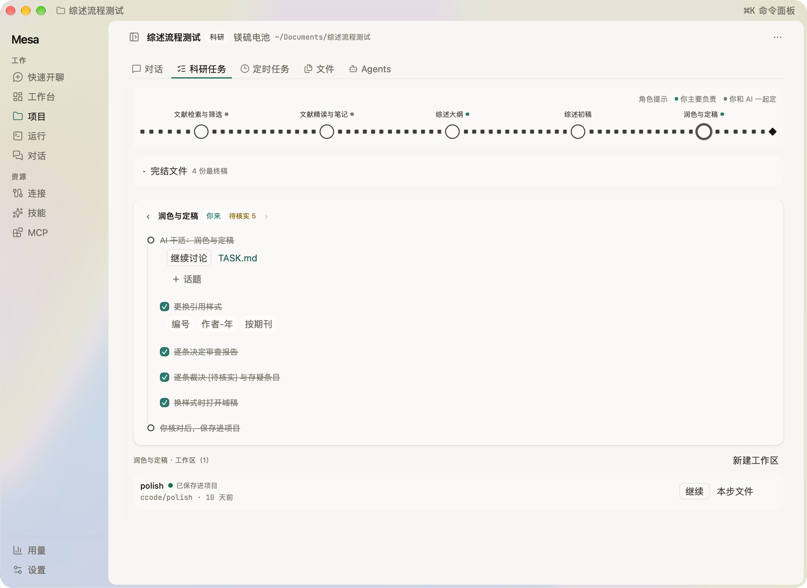

### 7.1 应用模板：五项全局设定

选 **英文综述** 后进入「「英文综述」的项目全局设定」。五项都是自由填写，会贯穿全部五步：

| 设定 | 怎么填 | 输入框里的提示 |
|---|---|---|
| 综述角度 | 这篇综述要回答的核心问题 | 领域全景 / 聚焦某个子问题 |
| 目标篇幅 | 目标字数或页数 | 读者预期，如期刊常见 6000-8000 词；不是初稿必须凑到的词数 |
| 读者与文风 | 谁会读、什么口气 | 偏同行专家 / 偏入门科普 |
| 去向 | 投哪里 / 用在哪 | 投期刊 / 毕业论文一章 / 课程作业 |
| 综述深度 | **标准档** 或 **严格检索档** | 标准档 / 严格检索档 |

**综述深度怎么选**

- **标准档**（默认）：常规叙述性综述的检索与筛选。
- **严格检索档**：强制做引文扩展（沿已纳入文献的参考文献继续查找相关文献），题摘与全文分两轮筛，`screening.md` 末尾附检索披露。它**不是系统综述**，不产出 PRISMA 流程图级别的结论。

拿不准的项点 **暂不填写，稍后补充**。空着的会以「综述角度：（…）」这样的括号形式留在 **⋯ → 项目设置** 的规则里，并出现在每一步任务书（`TASK.md`）的「待确认的全局设定」中；AI 开始执行或跟你商量时会先逐项问你，你确定后它才改那一行。最后点 **保存设定并应用模板**。

### 7.2 步骤卡通用操作（每一步都一样）

点任意一个大圆，下面出现**当前步骤卡**。从上到下三段：开始前要定的事（**先定几件事** 和需要你先完成的人工事项）→ **AI 干活：{这一步的名字}**（AI 执行这一步，主按钮在右侧）→ **你核对后，保存进项目**（按钮 **去评审**，即审核成果）。最底下隔着「可选」分隔线的是保存到项目之后才做的事。行随内容出现，没有的不占地方。

#### 操作流程

1. **开始前**：点 **跟 AI 商量一下**——AI 通读这一步的任务书，逐个问你拿不准的地方，按回答修改任务书；商量过按钮变 **继续讨论**，接回上次的对话，不新开。
2. **点 开始**：先弹出开始前确认窗口，标题 **开始 {步骤名}**。列出：本步产物、读入（已有的输入，缺的必填写成「文件名 · 还没有」；攒过文献的课题这里还会多一枚 **积累 N 条** 芯片）、这次用哪个 Agent（旁边 **更换**，默认 Agent 在项目的 **Agents** 页签设）、可展开修改的任务书；权限一行固定写「可写：步骤工作区、项目根 papers/（原始文献）」——步骤工作区就是这一步的工作副本，AI 生成的表、图、稿件都写在那里，经你审核、保存到项目后才进入项目文件夹；文献 PDF 属于原始资料，直接进 `papers/`。项目文件夹里有还没存进历史记录的清单新行或你写的笔记时，还会多一个勾选项 **一并带上未保存的清单与笔记**（默认已勾上）：勾着就在开始前把它们存进历史记录，本次运行直接用得上；取消就按现状开始，它们不进本次运行，也不影响之后保存。点 **确认开始**。
3. **AI 执行**：主按钮变 **去终端看看**（回到这个对话查看执行进度，不是新开）。它需要你补充信息或做决定时，会在 **待处理** 里留一条「人工请求」，点进去用 **去终端回答** 回到对话里回复；你不回复，它按每条后面写明的兜底方案继续。
4. **审核成果**：AI 跑完时，**去终端看看** 旁多一行 **Agent 已跑完**，「你核对后」那行的 **去评审** 就绪。评审页的页签：检索步 **清单**、精读步 **笔记**、大纲 / 初稿 / 润色 **稿件**，另外都有 **过程 / 文件**。顶上黄字列出要留意的：摘要含 [待核实]、空白编号（G1…）、N 处「待绘制」。满意就点右上 **提交并保存进项目**（没有待提交改动时叫 **保存进项目**）；要改就写意见、或在稿件里划一段点 **加进意见**，然后 **退回修改**（接回原对话按意见改现稿）或 **按意见重写**（同一工作区新开会话，从大纲和笔记重写；会先确认）——这两个都**不会**保存到项目。
5. **保存之后**：可选区亮起（精读步是 **继续精读笔记 → 去笔记夹**）。模板里还有下一步时出现 **带到下一步**（把本步结论写进下一步的任务书）：点 **◈ AI 起草**，只写这一步已经确定、下一步容易改回去的决定，也可以自己写或留空——写进的是下一步的任务书，不是这一步的稿子。最后一步没有它。

#### 少见情况

- 确认窗口的按钮不是「确认开始」时：**先加连接** = 课题还没有能用的 AI 连接；**仅开始准备 / 先做无依赖工作** = 有决定还没批准，只做不依赖答案的部分；**仍要开工** = 上一步收尾事项没勾，先点「确认开始」，按钮变成它，再点一次才真正开始；**记下并开始** = 你改过本步要读的文件（比如精读后手改了笔记），点了先把改动存进历史记录再开始，新的工作副本才看得到。
- AI 在不该停的地方停下来问「要不要继续」：**不要再点开始**。点当前步或工作台的 **继续工作** 回到原终端，说「不必等我确认，做到完成标准」。
- **去处理冲突**（占掉去评审的位置）：工作副本和项目文件夹改了同一处（修改冲突）。按文件选 **任务版**（工作副本里的）或 **基准版**（项目文件夹当前分支上的，如 main），也能一键全部取基准版；要逐行合并，去预览编辑器手改。
- **恢复工作区**（占掉开始的位置）：这一步的工作副本已收起。
- **聊想法**：回到这张卡上次的对话。**◈ 写入任务书**（将讨论结论写入这一步的任务书）只在还没开始时出现：AI 先写出要追加的结论，你改完再写入。
- 没有「先定几件事」的步骤，**跟 AI 商量一下** 直接挂在 AI 那一栏，旁边是 **TASK.md**（打开这一步的任务书）。

### 7.3 第 1 步：文献检索与筛选

**目标：** 得到一份你确认过的纳入文献清单，能拿到的全文都进 `papers/`。开始时清单里已有的条目（你在雷达攒的、上一轮留下的）不会被清掉：AI 把它们和这一轮检索到的放在一起**统一去重**，当作起点接着筛。

#### ① 开始前：三件需要你完成的事

**确定文献来源**（整个课题只在这里问一次）：

| 选项 | 适合 | 之后去哪 |
|---|---|---|
| **让 agent 检索** | 从零开始 | 「去补几篇 →」可先手动放几篇种子文献 |
| **我有 Zotero 库** | 已在 Zotero 里攒了文献 | 「去导入 Zotero 库 →」 |
| **我有 EndNote 库** | 已在 EndNote 里攒了文献 | 「去放入 EndNote 题录 →」：导出 XML 或 RIS 放进 `papers/imports/` |
| **我已有 PDF / 题录** | 手里有一堆 PDF 或 .ris/.bib | 「去放入题录 / PDF →」 |

这些链接都跳到 **项目设置 → 文献与数据**。选了 Zotero，检索步以你的库为起点（盘点已有、查漏补缺），PDF 留在原处不搬；zotero-sync 技能挂在后面的定稿步，负责出 Zotero 域稿。

**Zotero 用户的建议设置：**关掉「自动重命名附件文件」，打开「自动检索 PDF 元数据」。要与项目共用同一份 PDF，用「链接到文件」，并把链接附件根目录指到项目的 `papers/`。
**EndNote 用户注意：**不要把 `papers/` 设为 EndNote 自动导入文件夹（它可能把 PDF 搬走）；导入题录不读 `.enl`（要用 EndNote 导出的 XML 或 RIS），到定稿出 Word 域稿时才会按你指定的 `.enl` 路径只读一次做记录号绑定（见 7.7）。

**配置学术检索 MCP**（推荐）：点 **Consensus** / **Undermind** 跳到 MCP 页预设。

- Consensus：填 API 密钥（填在密钥栏，不要写进命令）。
- Undermind：点 **去终端登录** 做一次浏览器授权。
- 两样都齐了这一项自动打勾；缺哪样旁边会写「Consensus 还没填密钥」「Undermind 未登录」等。
- 不配也能跑，AI 会用 OpenAlex 等免密钥来源。

两家都有免费额度，国内可直连：

- **Consensus**（[consensus.app](https://consensus.app)）：注册后申请 API Key，费用见[定价页](https://consensus.app/pricing)。
- **Undermind**（[undermind.ai](https://undermind.ai)）：注册即用，OAuth 授权、无需 Key，Pro 约 $16–20/月。

**登录学校账号**（有付费墙文献时）：见下文 ④。

#### ② AI 做什么

1. 按综述角度拆概念块，写成 OpenAlex 的一条检索式，先看命中数再取回。近义式不另开一轮。
2. 去重，按拟定的纳入 / 排除标准初筛。已配置的 Consensus / Undermind 各补一轮。
3. 把初始命中数和建议标准写进 **待处理** 的「人工请求」问你。全局设定里标准已经写明时，不再为同一件事停一次。
4. 标准档不做引文扩展；严格检索档才做，并分题摘、全文两轮筛。
5. 只下载已给出 PDF 直链的开放获取；连续 3 次 403 打不开就停、不换链重试，其余列进 `to-fetch.md`。纳入且缺全文的篇目写两套 RIS（待确认的不进）；纳入和待确认补期刊缩写，排除的不补。

`screening.md` 的固定结构：深度与假设 → 纳入 / 排除标准 → 概念块与检索词 → 检索日志表 → 逐篇决定 → 引文扩展轮次 → 覆盖缺口声明（严格档再加检索披露）。RIS 和 BibTeX 都是文献题录的交换格式，EndNote、Zotero 等文献管理软件可以直接导入。

#### ③ 你来决定：核对待确认篇目

人工事项 **核对待确认篇目** 展开是一份三段清单。还有待确认篇目时，这一行右边是黄字「待确认 N 篇」，不再标 **可选**——清单折起来也能看到还剩几篇要你决定。清单几百篇、每篇带摘要也能整份打开和保存。

- **待确认**：每行标题、年份、作者、期刊，贴 **IF**、中科院 **N区**、**TOP** 标签（1 区和 TOP 用强调色，2 区绿，3 区黄）。有 PDF 的标题可点，在文件页预览。
  - 单篇 **纳入** / **排除**；批量先勾选，再 **纳入所选** / **排除所选**。每行标题前是一个方框，勾上显示 ✓。**全选** 只选当前看得到的行。同一行右侧是指标表状态和 **排序**（清单原序 / 影响因子从高到低 / 从低到高）。没有待确认时，这两项单独靠右。
- **已纳入**（在待确认下面）：单篇 **移出**（鼠标移到那一行，行尾才出现），或勾选 / **全选** 后 **移出所选**。作者只列前三位加「等 N 人」，鼠标停在作者上看全部；有 PDF 的篇目在作者那行末尾标「有 PDF」，点标题打开。移出 = 改成排除，从纳入清单、待获取、两份 RIS 里拿掉；PDF、笔记、`references.bib` 不动（已有笔记时行上会提示去精读步清理）。判定写成 `include` 也算已纳入。
- **已排除**（默认折叠）：**恢复为待确认**（同样是鼠标移到那一行才出现）。恢复不会自动写回待获取，再次纳入才补上。

全部篇目都处理完，这一项自动打勾。

**影响因子标签**需要先下载期刊指标表（两份约 4MB + 2.7MB，有版权不随安装包）：还没装时，清单顶上点 **下载期刊指标表**。装上之后，状态写在待确认那一行的右侧，例如「指标表已是最新」或「指标表有新版」+ **更新**。没装表时没有标签，也不会编数字。

#### ④ 付费墙全文：下载付费墙文献全文

纳入但没有 PDF 的篇目进人工事项 **下载付费墙文献全文**，展开 **待获取（还缺 N 篇）**，一行一篇。**一篇一篇来，不要批量下载**，出版商会封学校 IP。

**先登录一次学校账号**：点 **登录学校账号** → 打开 **设置 → 网络**，默认走 CARSI，选学校、完成账号和二次验证。登录在你的浏览器里完成，Mesa 不存密码。会话已经保存时，这里显示 **已登录**，不再是按钮。校外打不开全文时，展开 **校外打不开全文时**，贴图书馆「校外访问」链接（形如 `https://proxy.学校.edu.cn/login?url=`），之后点「官网」会先走代理。

**每一篇三个动作：**

1. **官网**：默认浏览器打开出版商页面，你用网站自己的下载按钮下 PDF。按钮变成 **等待收货…**（旁边有 **取消**），约 90 秒内落下的 PDF 会收进 `papers/`，行上变 **✓ 已存**。
   - Mesa 会看系统「下载」文件夹，以及 Chrome、Edge、Firefox 设成默认的下载文件夹。
   - 装了 Mesa 文献收货扩展（Chrome / Edge）时，下到别的文件夹也能收到。
2. **关联**：已经下到别处的 PDF，点它选文件，复制进 `papers/`，原件不动。也可以把 PDF 拖进这份待获取清单。文件名不对时，Mesa 读 PDF 里的标题去对条目。对上一篇就保存；对上多篇或一篇都对不上，会提示改用这一行的 **关联**。
3. **核对**：变成 ✓ 已存后，点标题跳到文件页看 PDF，确认是这一篇。切回「科研任务」，清单停在原处。

文件名对不上时右下角会弹横幅，可以一键收进刚打开的那篇。实在下不到的可以不补，这篇之后按摘要处理。


#### ⑤ 产出与完成标准

| 文件 | 内容 |
|---|---|
| `papers/screening.md` | 检索全过程（可复现） |
| `papers/included.md` / `included.json` | 纳入清单（json 里也留着被移出的记录和理由） |
| `papers/to-fetch.md` / `to-fetch.ris` | 待获取清单；RIS 给 Zotero |
| `papers/endnote-import.ris` | 给 EndNote 的题录 |
| `papers/zotero-sync.md` | 仅文献来源选 Zotero 时 |
| `papers/*.pdf` | 全文 |

评审页 **清单** 页签顶上是「纳入 N · 待确认 M · 待获取 K · 共 T 篇」；**过程** 页签是检索日志。

**怎样算做完：** 待确认为 0；你看过检索过程，覆盖缺口可以接受；能补的全文都补了；**保存进项目**。

---

### 7.4 第 2 步：精读笔记

**目标：** 每篇读完的文献都有一份结构化笔记，`references.bib` 齐全。

#### AI 做什么

确认精读篇目后，AI 逐篇读 PDF，**只给读完的篇写笔记**，没读完的在索引里记 pending，不算「已读」。某一篇已经有笔记（你自己读过写的、或上一轮流程写的）时，AI 在那份笔记上**接着补全**，你写的「我的想法」「译段」和批注原样保留，不另起一份。把英文摘要整段贴进来不算精读。叙述用中文，术语可留英文。每篇八段：

1. 一句话总结
2. 研究问题
3. 方法
4. 主要结果
5. 局限（分「作者自述的局限」和「本笔记识别的局限」）
6. 可引用点（末尾标可引用图：可拼 / 仅引用）
7. 与本课题的关系
8. 疑问与待跟进

同时往 `references.bib` 追加规范 BibTeX 条目。

AI 写的过程中，**AI 干活** 下面有一行进度：「已写笔记 N / M 篇 · 全文 a · 仅摘要 b」，不用等到评审才知道读到哪。

#### 你做什么：抽查 3 篇笔记（可选）

AI 交付后、保存进项目前，人工事项 **抽查 3 篇笔记** 下面直接列出挑好的三篇（全文精读和仅摘要各至少一篇，每次打开是同样三篇），右边小字标「全文」或「仅摘要」。点一篇在运行页预览打开，对照原文看三件事：一句话总结与主要结果对得上 PDF；可引用点里的图号在原文里找得到；仅摘要的没有写成读过全文。有问题回终端让 AI 改这几篇并复查同类，不用自己重写；看完打勾。不抽查也能保存进项目、开下一步。

#### 你做什么：三栏沉浸阅读

在 **文件** 页悬停 PDF 或 `notes/` 里的笔记，点 **⛶ 沉浸阅读**（示例课题的精读步可直接点 **开读这一篇**）。屏幕分三栏：

- 左：**笔记**（已有笔记会自动配对）。新建的笔记八个小节都空着时，顶上有 **让 AI 起草**，点它由右栏的 Agent 读全文写八段
- 中：**PDF**，可滚动、缩放、选字；工具条有查找（⌘F / Ctrl+F）、**目录**（PDF 自带书签时才有）、点页码跳页
- 右：**Agent 终端**，随时问。它改文件前会先问你，改本课题 `notes/` 下的笔记例外（Claude Code）

在 PDF 里选一段，浮动条有 **译**、**高亮**、**◈ 问 AI**、**＋ 生词**（选段较短时）和 **⋯**（**＋ 批注…**、**↵ 直接发送**）。高亮和批注记进这篇笔记的「标注」一节，下次打开还在；点 PDF 上的高亮可以看批注、回到笔记那一行或删掉。笔记里写的 **p.3**、**Fig. 2**、**第 3 页** 这类页码和图号可以直接点，PDF 跳过去。工具栏 **圈选** 可以框一块区域，再 **◈ 发给 agent** 或 **＋ ** **插入笔记（保留值得借鉴的数据图）**。

按 **Esc** 退出（在圈选模式、查找条里先退出它们）。退出后回到进入前的页面，右栏这次自动开的那段 AI 对话一起停下。

#### 可选事项（保存进项目后才能点）

- **继续精读笔记 → 去笔记夹**：打开文件页的 `notes/`，继续挑一篇三栏阅读。
- **同步到文献库**：**同步到 Zotero**、**同步到 EndNote**、**打开 papers**。按 `references.bib` 重写 RIS 后交给对应软件；**同步到 Zotero** 只交库里还没有的条目——已有的自动跳过，全都已在库时会直接提示「新增 0 条」、不再拉起 Zotero，所以重复点不会养出重复条目。两个同步按钮都会先只读体检你的库：发现以前导出的脏记录（DOI 带下标、标题格式坏）会点名列出，照提示先删再导即可。同步完把 PDF 从 `papers/` 拖到库里对应条目上。PDF 要拖到 EndNote 里对应的那一条上；拖到库列表的空白处会另建一条重复记录。

精读后又手改了笔记：开始大纲步时，确认窗口里写「开始时会先记下 N 个这一步要读的文件，再开工」，按钮是 **记下并开始**，点它即可，大纲步就看得到。

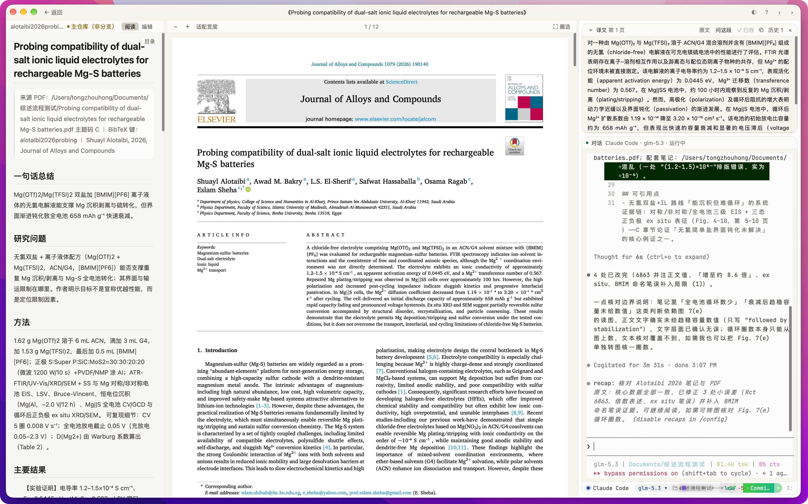

**怎样算做完：** 纳入篇目都有笔记或明确的 pending 理由；文件页「已读」对得上；**保存进项目**。


---

### 7.5 第 3 步：大纲（你来）

**目标：** 一份有论点、有研究空白支撑的章节框架，而不是把文献按主题堆起来。

#### AI 做什么

1. **判定综述形态**（叙述性、主题式、方法比较等）。
2. **提炼研究空白清单**：从笔记的「局限」「可引用点」和文献前言里抽，每条标类型（证据 / 知识 / 实践 / 方法 / 经验 / 理论）。只有一篇来源支撑的标 **孤证**。
3. **拆解适量有代表性的权威综述**（篇数按问题定，不凑数量），每篇写成一张五要素范式卡片。
4. **融合构造框架**：范式做骨架，空白做导向。
5. `outline.md` 末尾写 **## 框架推演**（空白清单 / 范式卡片 / 融合理由），加覆盖声明和完成自评。

#### 你做什么

这一步角色是「你来」，大纲决定了后面全部写作。审核时重点看：

- 核心论点是不是你想回答的那个问题（对照「综述角度」）。
- 研究空白是否真实，孤证是否被当成了定论。
- 章节顺序是否讲得通，有没有漏掉你知道的重要方向。
- 选的范式综述是否是领域公认的。

不满意就写意见 **退回修改**；方向完全不对就 **按意见重写**。

**怎样算做完：** 你认可框架推演里的融合理由；**保存进项目**。

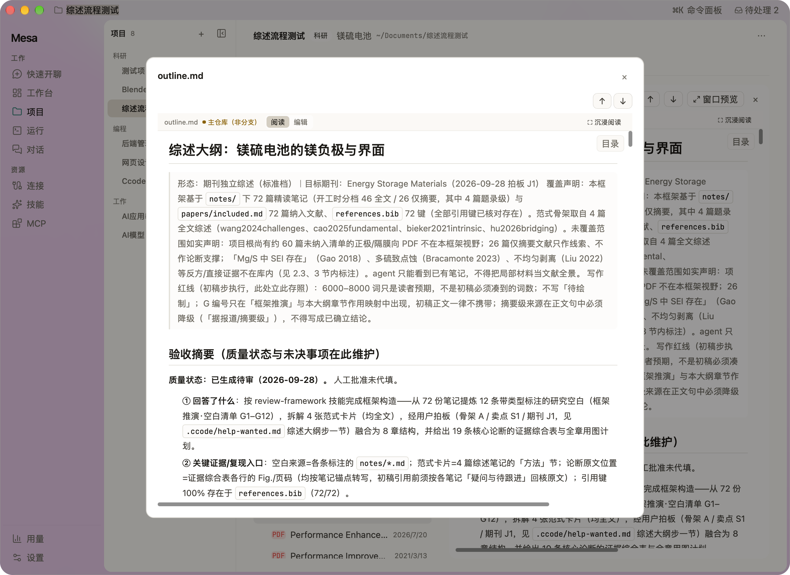

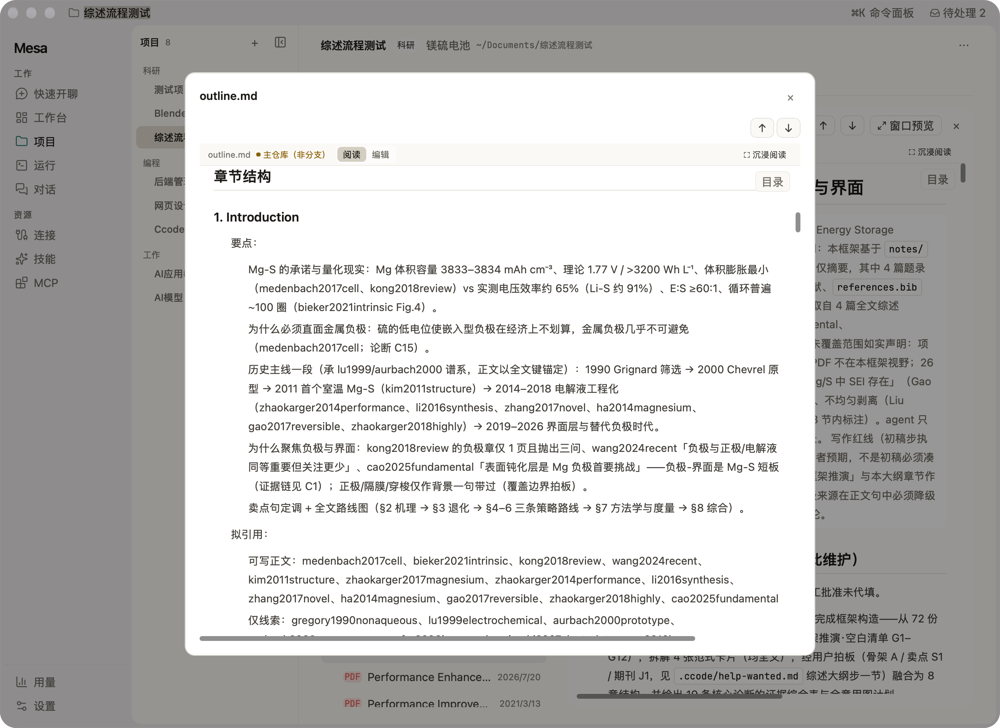

---

### 7.6 第 4 步：初稿

**目标：** 一份完整英文初稿，能渲染成 PDF 和 Word。

#### 开始后你要回答：正文字体

初稿开始后、第一次渲染前，AI 会问一次正文字体。默认英文 **Times New Roman**、中文 **宋体**，可以改成别的名字。字体必须在本机装好，没装会直接报错，不会偷偷换字体。定稿沿用这一套。

这个问题在 AI 开始执行后的对话里问，不在「跟 AI 商量一下」里（那边只改任务书）。回答会写进 `manuscript/typeface.md` 和 `manuscript/reference.docx`，第一次渲染就用这套字。字体脚本同时在稿件开头的 YAML 里写上 Word 模板（`format.docx` 的 `reference-doc`），所以不管是流程线上的渲染脚本还是 AI 手敲的命令，出来的 Word 都是这套字；Word 打开是等线，就是这一行丢了，让 AI 补上再渲。

#### AI 做什么

- 按大纲、笔记、`references.bib` 写正文。遵守 review-writing 规范：
  - 观点先行，引用为证，不堆砌文献。
  - 引用只用 `[@bib键]`，**严禁编造文献**。
  - 没有依据的论断标 **[待核实]**。
  - 按大纲的用图计划出图；裁不到源图就改成「见 [@键] Fig.n」，不写「待绘制」占位，也不虚构数据。
- 引用样式固定为方括号编号 `[1]`，这一步不问。
- 需要文献图时，从论文 PDF 裁源图、拼 panel（review-figures）；不能拼的改成「引用 Fig. n」。源图放 `figures/`。
- 用 Quarto 渲染 PDF 和 Word。

#### 你做什么：审核稿件

**稿件** 页签里 Word 在 PDF 前面；PDF 页签先看有没有乱码。顶上黄字列出 [待核实]、空白编号（G1…）、「待绘制」的数量。

- 逐段看论证和引用是否对得上。怀疑某个引用，打开对应笔记或 PDF 核对。
- 划一段 → **加进意见** → 写怎么改；全部写完 **退回修改**。

**怎样算做完：** 结构和论点你认可；[待核实] 的数量你心里有数（定稿会逐条处理）；**保存进项目**。

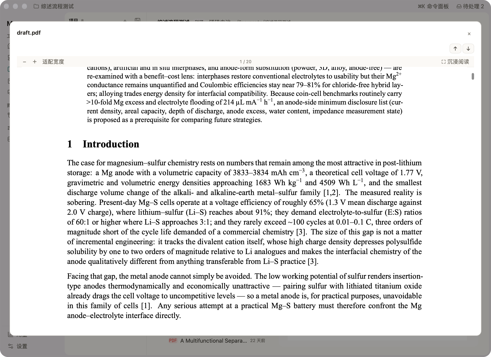

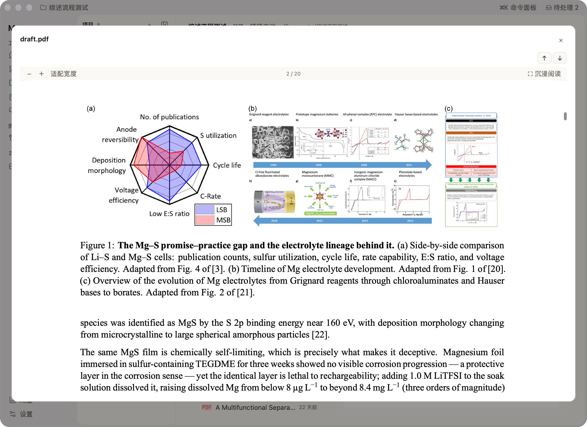

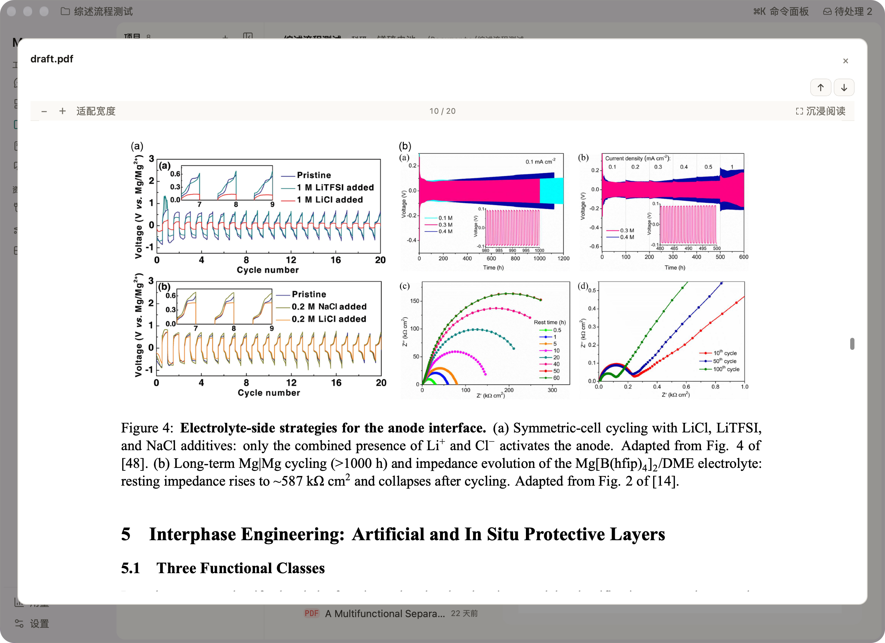

---

### 7.7 第 5 步：润色定稿（你来）

**目标：** 可投稿的终稿，正文引用与参考文献一一对应，四种格式齐全。

#### ① 开始时：引用样式

AI 开始时不问引用样式，先按初稿的方括号编号做。想换，随时在流程线上点 **更换引用样式**（沿用编号就直接勾掉这一行）：

| 类型 | 选项 |
|---|---|
| 编号 | 方括号 `[1]`、上标 `¹` |
| 作者-年 | `(Author, Year)`、`(Author Year)` |
| 按期刊 | 从文献里出现最多的期刊中选，或自己填刊名 |

选「按期刊」时，AI 先读该刊作者须知，再拿 `references.bib` 里该刊最近 2–3 篇综述核对实际排法；两边不一致会停下来问你。确认了期刊才会写 `submission/target-journal.md`；沿用编号时不写。

选定后 AI 回到这一步原对话，重新渲染 PDF 和 Word，并重新生成两份带引用域的 Word。

还没换样式时，AI 沿用初稿的编号照常渲染，不会停下来等你。

#### ② AI 做什么

- 按审查规范写一份**审查报告**：语言、逻辑、引用、统计口径（stats-check）、引用核对（bib-check：正文引用与 `references.bib` 是否一一对应、疑似编造、未引用条目）。
- 润色只改表达，不改观点。改动了数字、因果、样本或结论范围的，单列在修改记录的「科学改动」里。

#### ③ 你做什么：逐条确认处理意见

报告写出后，步骤上出现一条条审查意见，每条由你决定怎么处理：

- 每条选 **接受** / **拒绝** / **修改**（选修改必须写一句要改成什么样）。
- 或点 **全部接受**。
- 全部点完后点 **让 Agent 按决定继续**，AI 回原对话改稿。拒绝的不改。

人工事项 **逐条裁决**（逐条确认待核实条目的最终结论）只在定稿还有 [待核实] 或引用存疑时才有条目（每条「裁决：」都填完、没有「待裁决」才算完成）；没有条目时写「勾上跳过」。

「域稿」指正文引用写成 Word 域、与你的文献库绑定的两份 Word（`endnote.docx`、`zotero.docx`），下面单独说明。

#### ④ 产出

| 文件 | 用途 |
|---|---|
| `output/*.pdf` | 阅读、投稿 |
| `output/*.docx`（Quarto 渲染） | 只供阅读，换不了文献软件的样式 |
| `output/endnote.docx` | 先开 EndNote 应用、等它加载完，再用 Word 打开 → **Update Citations and Bibliography** 一次。首次打开若插件无反应（按钮灰），是 EndNote 还没就绪——等它加载完，或关掉文档重开一次，文档本身没坏 |
| `output/zotero.docx` | 先开 Zotero 应用、等它加载完，再用 Word 打开 → Zotero 工具栏 **Refresh**（首次会弹引用样式选择框，选一次即可；插件无反应就等 Zotero 就绪或重开文档）→ 光标点进 References 标题**下面的空行**（点在标题行上会把参考文献表插到标题上方、还继承标题大字号；插错了撤销，光标点对再点一次），点 **Add/Edit Bibliography** 插入参考文献表 |
| `submission/target-journal.md` | 仅确认了目标期刊时 |

拼图会嵌进两份域稿。LaTeX 稿不交这两份。Mesa 不会替你点 Word 里的按钮。

**怎样算做完：** 审查意见和待核实条目全部处理；正文引用与参考文献一一对应；PDF 和 Word 打开无乱码；**保存进项目**。

#### 域稿与参考文献库联动：换格式不用一条条改

**解决什么问题**：投不同的期刊要换不同的参考文献格式（作者名顺序、期刊缩写、页码格式、标点），一条一条手改，一轮几十条就是一两个小时，还常漏。域稿把每条引用从「死文字」变成**绑定你文献库的 Word 域**——这个问题整条消掉。

**怎么工作**：检索步同步题录入库 → 定稿步每条 `[@键]` 写成域（域里带库里的记录号）→ 你点一次 Update/Refresh，EndNote 或 Zotero **自动生成整张参考文献表**，不用碰任何一条。

**换期刊的实际操作**：假设从投 ACS 改投 Nature——

- **EndNote**：插件栏 Output Style 下拉选 *Nature* → 点 **Update Citations and Bibliography** → 全部引用和参考文献表立刻重排。30 秒。
- **Zotero**：插件栏 **Document Preferences** 选 *Nature* → 点 **Refresh** → 同样全局重排。
- 学位论文换学校模板格式也一样，只是换个样式再刷新。

**为什么可靠**：域绑的是库里的记录，不是复制粘贴的文字——库里改了信息下次刷新自动带进；同一篇引五处格式永远一致；合作者用 traveling library 兜底，没有你的库也能打开。

**注意**：手动在 Word 里改参考文献表，下次 Update/Refresh 会覆盖——需要改的信息去库里改。

**EndNote 演示（86 秒）**


**Zotero 演示（144 秒）**


### 7.8 完结文件

五步都保存到项目后，项目卡上出现 **完结文件**（最终成果文件汇总），一处看全所有交付物：

- 最终稿 / 可以接着改的稿
- 图
- 文献从哪来（检索记录、纳入清单）
- 核对与修改（审查报告、修改记录、待核实条目的处理结果；目标期刊只在写过那份文件时才列）
- 精读笔记（每行是论文题名，右边是对应 PDF，没有全文写「无全文」）

后来又追加了步骤、还没做完时，这一块先不出现。

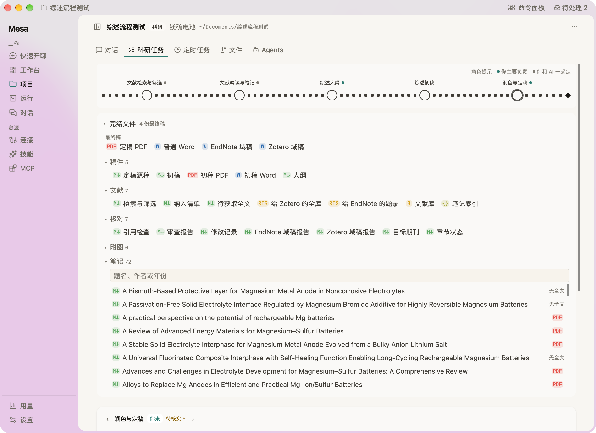

### 7.9 常见问题（综述流程）

| 现象 | 处理 |
|---|---|
| AI 做了一半停下来问「要不要继续」 | 不要点「开始」。**继续工作** 回到原终端，说「不必等我确认，做到完成标准」 |
| 下一步看不到我手改的笔记 | 在开始前确认窗口里点 **记下并开始**；已经开始了的话，回项目文件夹把改动存进历史记录，再 **退回修改** 让 AI 重读 |
| 待获取点了官网一直不变已存 | 看是否超过约 90 秒、是否下到了没被监视的文件夹；用 **关联** 补 |
| 渲染失败、PDF 出不来 | **设置 → 诊断** 看 Quarto、TeX 是否 ✓；字体是否装在本机 |
| 拼图失败 | 诊断页 PyMuPDF、Pillow 是否 ✓ |
| 想中途换目标期刊 | 流程线 **更换引用样式 → 按期刊** |
| 正在做的课题想换新版模板 | 不要整套替换。已有课题保持原步骤，新课题才带新要求 |

---

## 8. 其他科研模板与不使用流程

### 8.1 其他模板

| 模板 | 步数 | 路径 |
|---|---|---|
| **科研论文** | 8 步 | 文献检索与筛选 → 精读与研究空白 → 实验设计 → 执行 → 分析 → 论文大纲 → IMRaD 初稿 → 投稿准备。湿实验或问卷要自己改实验步 |
| **数据处理** | 4 步 | 数据登记与质量检查 → 清洗整理 → 探索性分析 → 结论与建议报告 |
| **毕业论文** | 8 步 | 文献检索与筛选 → 精读笔记 → 开题报告与综述 → 研究方法 → 实验执行 → 结果分析与章节 → 全文初稿 → 格式与定稿 |
| **投稿与返修** | 卡片上 2 步 | 首投是期刊格式适配 → 投稿材料。点进去先选 **首投** 或 **返修**；返修按轮次，每一轮是「审稿意见回复（第 N 轮）」 |
| **LaTeX 论文** | 4 步 | 搭建骨架 → 章节写作 → 编译与排错 → 定稿导出。有成稿就转排版，也可以从笔记从零写 |

步骤卡的操作和第 7.2 节完全相同。润色、定稿、期刊格式、返修步都会先写审查报告，再由你逐条确认处理意见。

**投稿与返修** 先选分支。

- **首投**：期刊格式适配 → 投稿材料。材料包括 cover letter、投稿前自查、投稿清单。
- **返修**：填返修轮次。这一步叫「审稿意见回复（第 N 轮）」。你先把编辑来信存成 `reviews/round-N.md`，AI 再写回复信、修订稿和修改对照。科学改动要你逐条决定之后才进修订稿。

科研论文、数据处理、毕业论文、LaTeX 论文的逐步说明还没有单独写。点进去之后，每一步的卡片和英文综述同一套操作。

### 8.2 不使用研究流程

适合只读文献、写笔记，或还不想定步骤。

科研任务页变成 **目标** 列表：**新建目标**，写一句话，可以先「记下」再「开始」。默认在工作副本里做。跑完按钮是 **验收产物**（即审核成果），勾选要留下的再点 **接受 N 项**。不满意写意见，点 **带着意见再出一版**，还是同一个目标接着改。

有研究流程时技能已挂在步骤上；没流程时在 **项目设置** 的规则里勾技能和「写回时跳过」路径。

---

## 9. 文献雷达：自动追踪新文献

项目的 **定时任务** 页，上半是 **文献雷达**（仅科研类课题；还没建雷达巡检任务时这一块不出现，删巡检会连它的关键词一起删）。

### 9.1 订阅

雷达卡头点 **订阅**，一条一行，只填**关键词**。arXiv、OpenAlex、Crossref 三个库都会查，每次回看最近 7 天、见过的自动去重；想限定库、改时间窗，用 **编辑源文件** 手写。**＋ 加一行** 加一条，行尾 × 删掉。也可以点 **编辑源文件**，在同一个弹窗里直接改这条巡检自己的订阅清单（先保存已在盘上的订阅，没存的改动不带过去）。还没有订阅且已建雷达巡检时，卡头写「文献雷达 · 还没订阅读」，旁边 **订阅关键词**；连巡检任务都还没建时这一行不出现，先去 **＋ 定时巡检** 建任务。

### 9.2 定时跑

**＋ 定时巡检** → 选 **文献雷达** → **每天** 或 **每周** 几点。**运行配置（可选）** 的提示是：「文献雷达选 Codex。没有后缀的只在课题目录里写。写着「会批准全部操作」的不要用于定时巡检。」

到点后在**隔离目录**（一份独立的工作副本）里运行，不直接改项目文件夹。雷达卡上写「N 篇新命中待采纳」；「待处理」出现「有 N 条新命中待评审」+ **去评审**。评审只列这一次运行新收的命中，一篇一行；**留下**是你的标记，**排除**＝这篇不要。点 **采纳进项目**（会先确认、查冲突、备份原文件）：排除的不会写入，其余进课题的雷达收件箱，PDF 进 `papers/`。之后按钮变 **已采纳**，历史行多一个「已采纳」标记、**去评审** 变 **查看**（只读回看当时的决定）。历史行悬停出现的 **✕** 可删掉这一条运行记录（已采纳进课题的内容不受影响）。

- 应用没开就不跑；下次打开补跑一次。
- 单次最多约 30 分钟。

### 9.3 读雷达

一条两行：第一行标题（`papers/` 里已有全文的，标题前有小文件图标、点标题直接打开），右边是 **推荐** / IF / 分区徽章；第二行中文一句话，右端是来源和日期。能免费下的 PDF 巡检结束时已经在 `papers/`。下不了的悬停那一行点 **打开来源** 去官网下载（约 90 秒内落下的 PDF 自动收进 `papers/`），或点 **⋯ 更多 → 关联本地 PDF…** 选已下载的文件。想留着的点 **加入积累**——记进积累清单 `papers/reading-list.md`，想读的时候去雷达卡的「积累」抽屉。

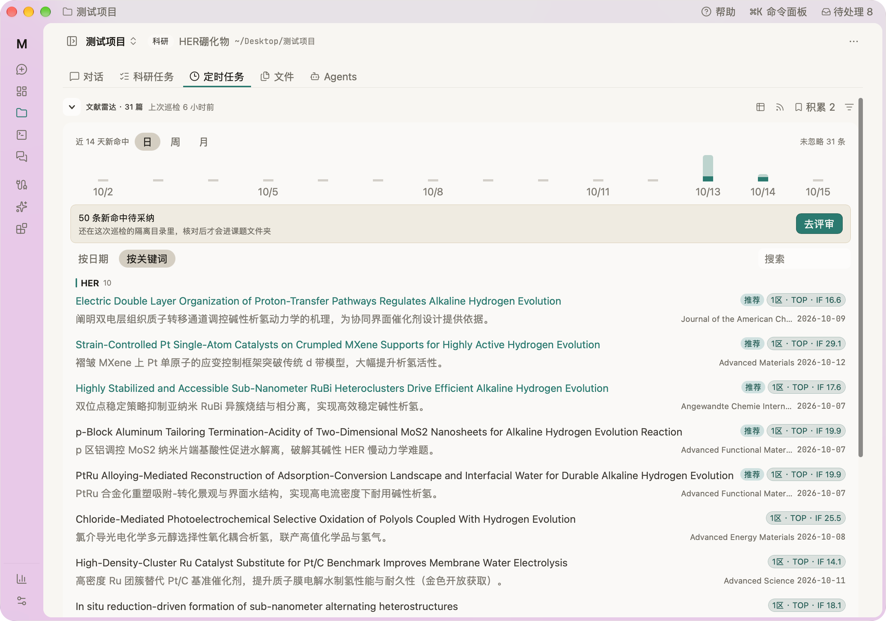

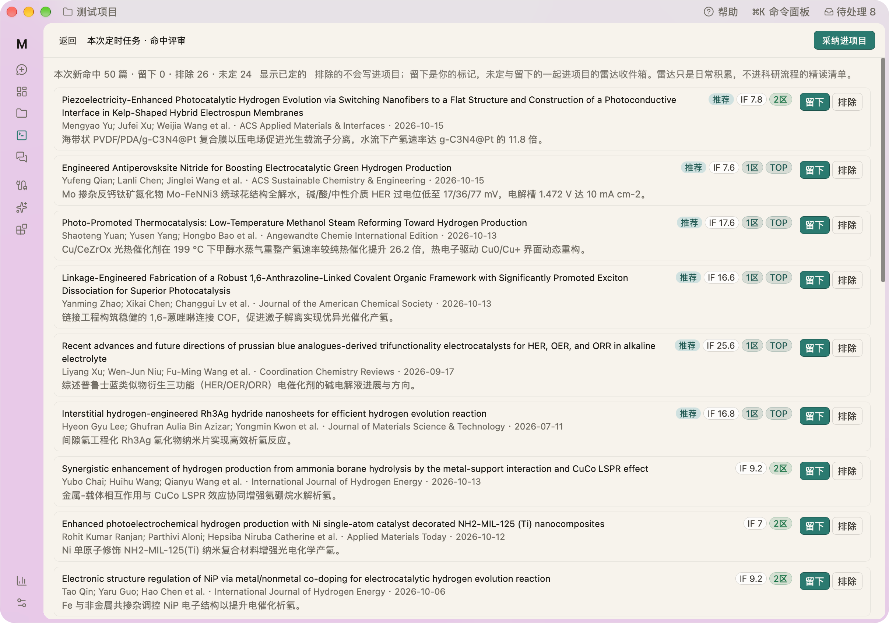

---

## 10. 运行页与历史对话

### 10.1 运行页

运行页一次摆一段对话（或一个终端）。顶上不再有一排标签（2026-10-24 起）：切到别的对话、开新对话、看谁在跑，都在左边侧栏——每个课题下面挂着它的对话，点一段就在这里打开。顶上一行是 **对话头**，写着这段的标题；右边三个图标：**>_**（看这段对话的终端，亮着时再点回到聊天）、**±**（右边打开这个文件夹的改动，有没提交的改动时图标上有个小点）、**⋯**（分屏对照、查找终端输出等）。聊天和终端是同一段对话的两种呈现：

- 聊天：Enter 发送，Shift+Enter 换行。输入框左边的 **＋** 加文件或图片、引用项目文件、插技能 / MCP（技能和 MCP 只插入提示，不替你发送）。
- 终端：各家 AI 原生界面，登录、权限确认、`/model` 在这里。

从侧栏点开一段旧对话：之前的内容先摆出来，AI 还没启动，输入框下面是它上次用的连接、模型和思考档，能改；发第一句才把它接回来。

终端那一面还没运行时，中间是「将在某某文件夹启动」和 **现在运行**，上方启动栏是 Agent / 配置 / 模型 / 思考 / 权限；跑起来后身份写在终端底下那一行，点它看「这次启动」，可以换权限、换连接接着聊。左边是这段对话所在文件夹的 **文件树**（点文件，右栏出预览），右栏还有 **改动**；文件树、对话、右栏三块的宽度都能拖。

- 状态看对话头标题后面、侧栏对话行尾的小光标（就是 Mesa 标志 M▁ 里那一道）：灰色一明一暗 = 正在干活；琥珀色 = 等你确认权限；淡灰 = 开着，在等你下一句。
- 几段 AI 同时在跑时，哪段这一轮做完了、你还没去看，侧栏里它的标题会亮成白字，点开看一眼就恢复。
- 回完话、你也没在看的对话，空闲 30 分钟 Mesa 会停下它的 AI，免得开着的越积越多；记录都在侧栏，点开发一句就接回。想立刻停：侧栏对话行尾 **⋯ → 停下 Agent**。
- 键盘：`⌃Tab` 回到刚才看的那段；`⌘0` 把光标放进侧栏，↑ ↓ 选、回车打开。
- 图或文件可以拖进聊天、⌘V 粘贴。选中终端里的文字有 **复制 / 复制文本 / 查看**。

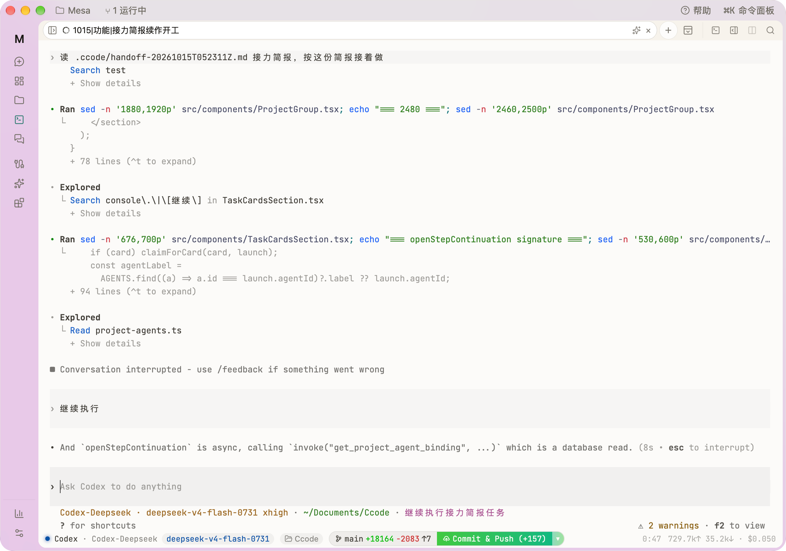

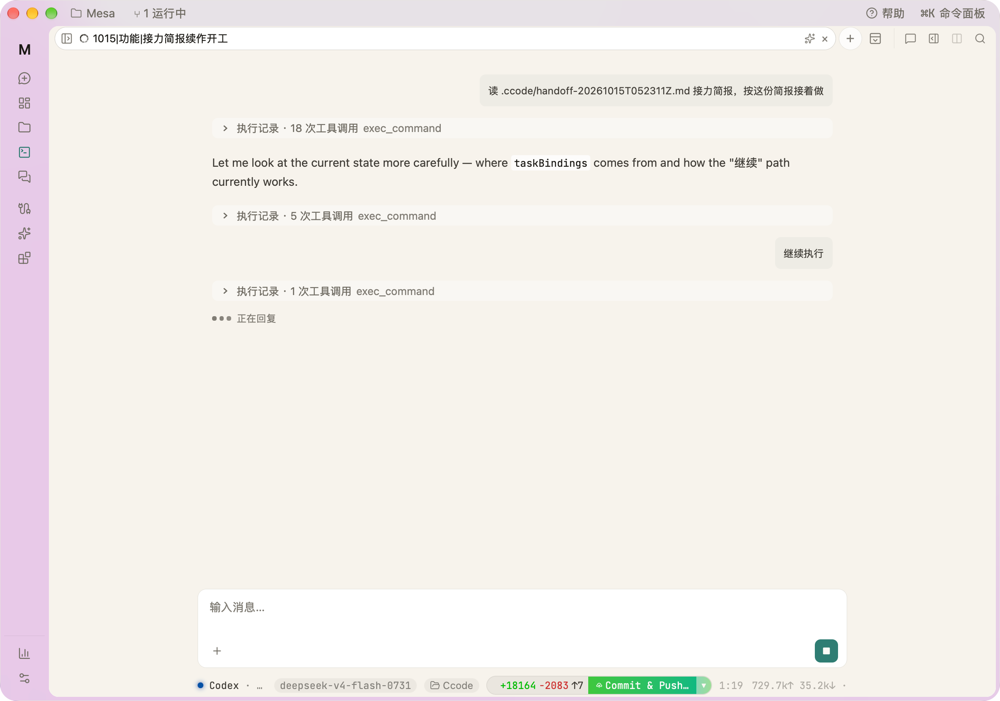

### 10.2 历史对话

日常找对话就在侧栏：每个课题下面列着它最近的对话，没列完的点 **展开更多**；常回去的几段点行尾 **⋯ → 置顶**，钉到侧栏最上面。跨课题找、按 Agent 或时间筛、归档、导出，点侧栏 **搜对话** 打开对话页（「项目」旁的放大镜也能对话和课题一起搜）。对话页里点一条回放，**继续** 回到运行页接着聊，**⋯ → 在外部终端继续** 在系统终端里继续。想换到图形客户端接着聊，见下面「在客户端里接着聊」。换电脑用 **导入 / 导出会话包**（会话包是把对话打包成的文件；原文可能带路径，发出去前先看一眼）。雷达、巡检这类后台 AI 在 **范围 → 其他 → Mesa 内部 AI** 里。

**在客户端里接着聊**（Codex 对话、Claude Code 对话，电脑上装了对应客户端才有）：

1. 回放底部点 **在 Codex 客户端打开**（Claude Code 对话是 **在 Claude 桌面版打开**），列表里右键这条对话也有。
2. Mesa 先检查一遍，没问题就直接打开，右下角提示「已交给 ××」。有事要你知道时会先弹一层，写清点了会发生什么：
   - Codex 客户端不认识这条对话的渠道（用 API 连接开的对话常见）：点 **写入并打开**，Mesa 把这个连接写进 `~/.codex/config.toml`（密钥明文，写前自动备份；想还原，到连接页 Codex 组头 **⋯ → 撤销上次写入**）。
   - Claude 桌面版会用它自己登录的账号继续，不会走你在 Mesa 里选的连接，点 **打开** 即可。
   - 这条对话还在 Mesa 终端里运行：两边同时写会互相覆盖，先在终端里结束它更稳。
3. 被拦下时（没装客户端、对话原始文件已不在）只给原因。其他几家 Agent 目前没有可接的客户端，不显示这个按钮。

打开后客户端自己提示登录或网络问题，Mesa 看不到，在客户端里处理完再点一次。工作台里项目行悬停的外开图标是同一套，只打开项目目录，不会定位到某条对话。

### 10.3 换一家 Agent 接着做

会话文件不能交给另一家。点下去才写一份简报到 `.ccode/handoff-<时间>.md`，新 Agent 读着新开一轮。旧对话还在。

1. 点开旧会话，回放右上角 **⋯**。
2. **◈ 接力到…** 把你的原话逐条原文写上，助手正文附在文末，不调用 AI。**◈ 提炼接力…** 再加一节「要接上的结论」（模型在 **设置 → AI 与 Agent → 接力与评审提炼**；可关窗口，做完进 **待你处理**）。
3. 选下一家。新会话开头读这份简报，并标成接自原来那家。

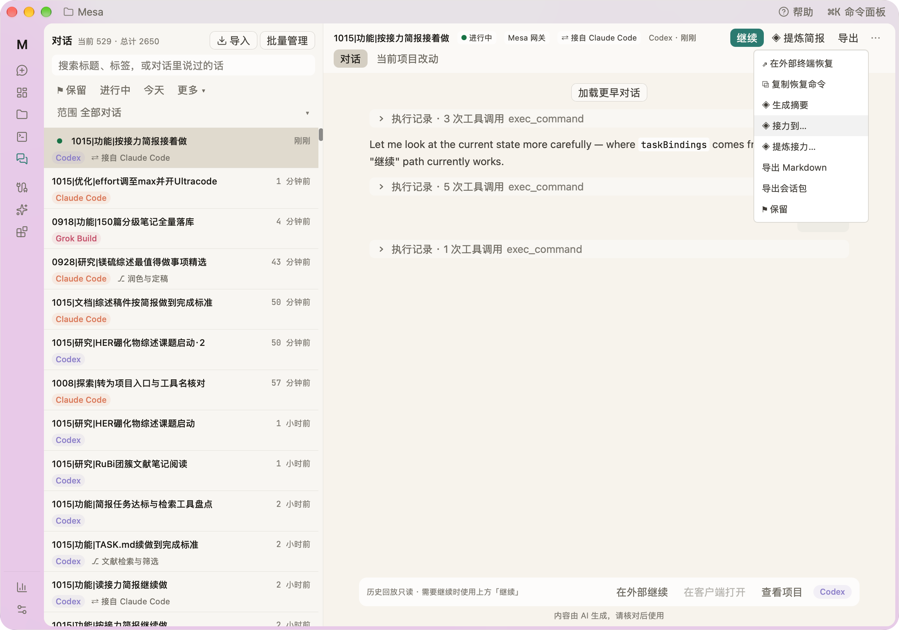

---

## 11. 「工作」项目与编程项目

**工作项目**：页签是 **工作任务**，写一句话作为目标，记下或开始。Word / 表格 / PDF 都能预览，旧 `.doc` 先另存为 `.docx`。

**编程项目**：主区是一张 **分支地图**——基准分支（如 main）在最上面，一棵棵 **工作树** 挂在它下面，每条写着「比 main 领先 N · 落后 M 个提交」；还没检出的本地分支收在最下面，展开就能给它建工作树。点 **从 … 开工**，起一个分支名，AI 在独立目录里改；改完查看改动，从工作树的 ⋯ **合并进基准** 或开 Pull Request。用 GitHub Desktop 时打开的应该是这棵工作树，不是主仓库。

编程项目的完整说明会按使用需求补充。

---

## 12. 技能与 MCP

**技能** 是给 AI 的短说明书。有研究流程时开步自动带上，不必手选。综述流程用到的内置技能：

| 技能 | 哪一步 | 管什么 |
|---|---|---|
| lit-search | 检索 | 分档检索、筛选、保留检索记录 |
| lit-notes | 精读 | 八段笔记、BibTeX |
| zotero-sync / endnote-bridge | 定稿（zotero-sync 在科研论文、毕业论文两套模板还挂检索步） | 文献软件桥接 |
| review-framework | 大纲 | 空白清单、范式卡片、框架推演 |
| review-writing | 初稿、定稿 | 综述写作约束 |
| review-figures | 初稿 | 从 PDF 裁图拼板 |
| quarto-render | 初稿、定稿 | 渲染 PDF / Word |
| bib-check、stats-check | 定稿 | 核对引用与参考文献是否一一对应、审查统计口径 |
| lit-watch | 定时任务（文献雷达） | 按订阅关键词追踪新文献，去重后进雷达收件箱 |

技能页可以创建、从 GitHub / ZIP 导入，用右侧开关分发给各家 Agent。内置技能只补没有的，不覆盖你改过的。页顶出现「内置技能有新版」时点 **查看差异**，确认后 **备份并采用新版**。

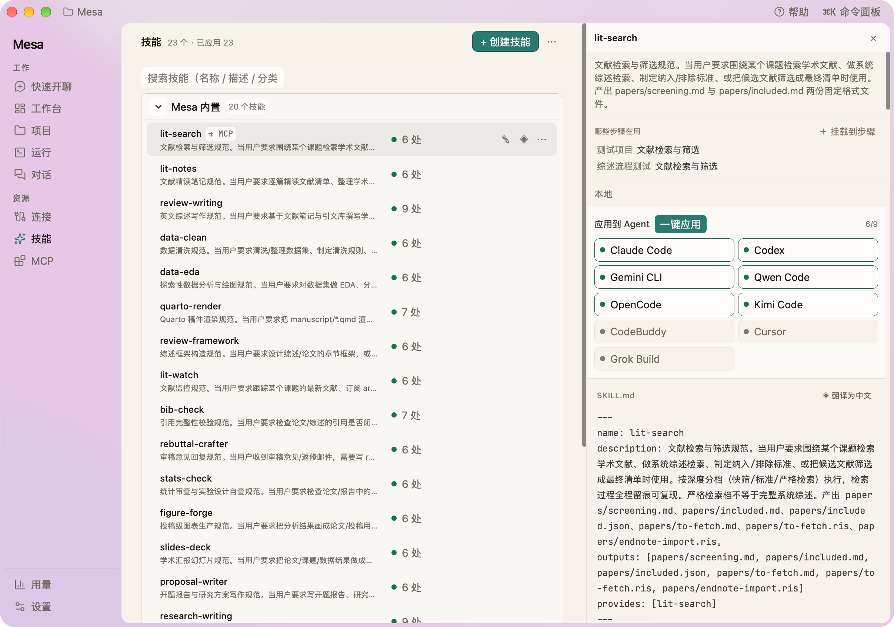

### 12.1 用你自己的技能顶替内置技能

**解决什么问题**：内置技能管的活（比如检索方法、笔记写法）你有自己的一套——自己写的技能、组里传下来的规范。直接挂上去会发现两处不对劲：步骤简报里还写着「按 lit-search 技能执行」（AI 还是照内置的做），精读步的「开读这一篇」「同步到 Zotero」这些按钮也不见了。2026-10-11 起，这两处都跟着你挂的技能走。

**怎么用，一步一步**：

1. **装进技能页**：创建 / GitHub / ZIP 导入都行（上面一段）。假设你的技能叫 `my-search`，管检索。
   - **库内派生支线（不想从零写）**：技能页点任一技能的 **◈ 优化** → 切「另存为新技能」→ 勾选几个源技能（比如内置 lit-search + 你自己的）→ 写一句优化方向 → AI 合成出新技能、你预览确认落库。内置的方法论是骨架、你的方向是增量，源技能一个字不动。预览屏上**新技能名可以改**（AI 起的名只是建议，你改什么名落库就是什么名）。
2. **适配到流水线**：技能页选中它，点 ⋯ → **◈ 适配到流水线**。AI 会按流水线的文件落点（papers/、notes/、references.bib 这些）改写你的技能，并**声明它能顶哪个内置位**——文件开头会多一行 `provides: [lit-search]`，意思是「检索这个位置我能干」。预览、改、确认后落盘。
3. **换到步骤上**：项目里打开 **编辑研究流程**，找到检索步，第 5 项「技能」里点掉 lit-search、添加 `my-search`，保存。开始前确认窗口里也可以就地增删。
4. **照常开始**：任务书（TASK.md）里会写成「全程按 my-search 技能执行」，简报不再指挥旧技能；文献同步、开读这一篇、文献雷达卡这些入口只要你的技能声明了对应位，就都在。

**怎样才算做成**：开始前确认窗口的任务书预览里看到你自己的技能名出现在执行指令里；步骤卡的相关按钮没消失。

**常见卡在哪**：

- **手写的技能没声明位**：frontmatter 里自己加一行 `provides: [lit-search]`（能顶几个位就写几个）。位名就是内置技能名——能顶哪个看 12 章那张表。
- **开始时被技能检查拦下**（提示「技能未安装、未启用到所选 Agent 或副本过期」）：技能还没分发给所选的那家 Agent。体检条上点 **去技能页分发**，打开右侧开关，回来点重新检测。
- **任务书里出现 `figure-forge` 这样的裸名字**（不是你的技能名）：说明简报点了这个位但步骤上没人占——回编辑器把对应技能挂上，或确认你的技能声明了这个位。技能标签下方也会提醒，不拦开始。
- **换完技能正文指令没变**：正文按挂载名单解析，挂了声明该位的技能才会替换；确认第 3 步保存成功。
- **合成稿丢了某个源技能的检查清单**：预览时逐个源对照一遍再确认——AI 合成是多源融合，漏项只能靠你在预览里把关。
- **落库报「已存在」**：新技能名跟库里撞了——在预览屏的「新技能名」框里换个名字再点确认（不用去动源技能）。

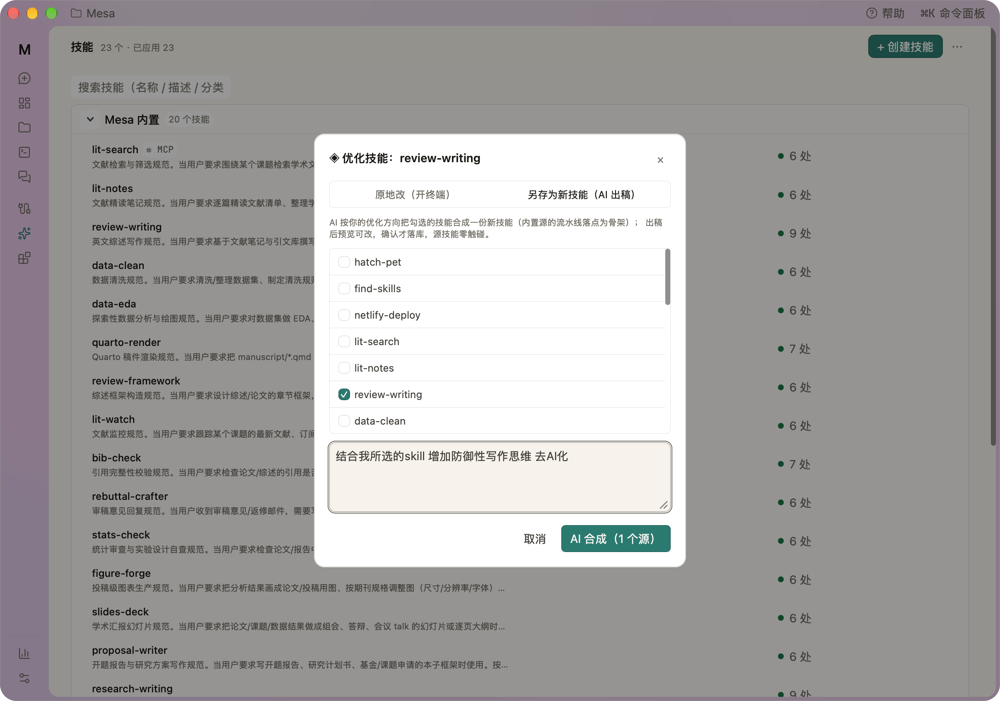

**MCP** 接外部服务。学术检索用 Consensus（预设 + 密钥）和 Undermind（预设 + 去终端登录），见 7.3。Grok 的 MCP 只能在 Grok 里用 `grok mcp add` 添加。Blender、Origin 是可选，用得上时再配（Origin 仅 Windows）。

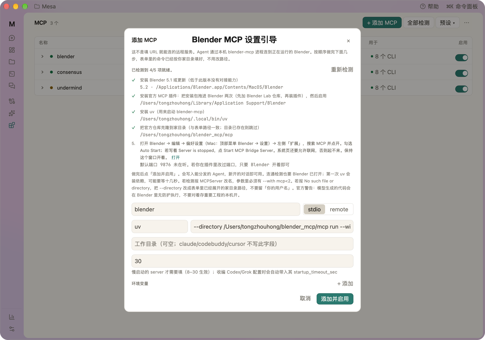

---

## 13. 用量、外观与设置

- **用量**：今天 / 7 天 / 30 天 / 全部花费；官方订阅显示「订阅」。配了智谱 Coding Plan、Kimi For Coding、MiniMax Coding Plan 时有 **订阅余量**；配了 New API 类预付钱包网关时有 **网关余额**（需在网关库填系统访问令牌）。

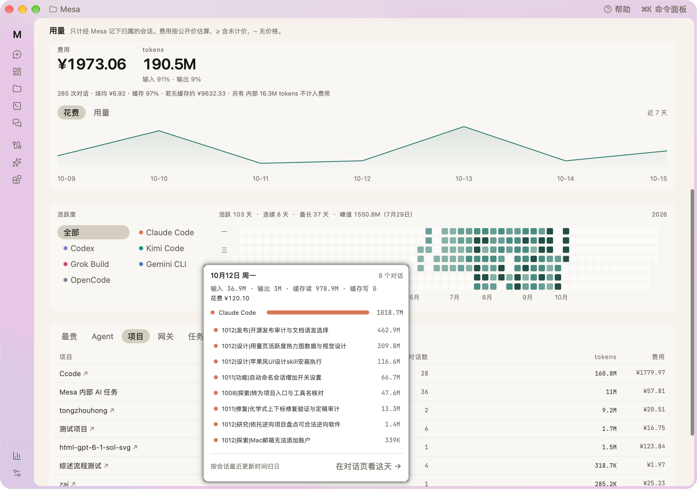

- **设置 → 外观**：七深七浅主题，可自定义三色；侧栏 / 顶栏透明度可调。

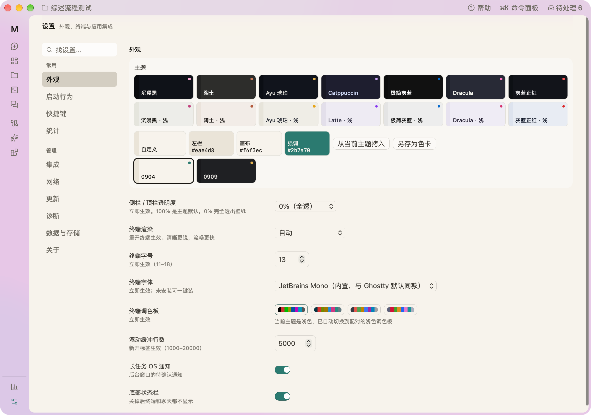

- **设置 → 终端**：终端的渲染方式、字号、字体、调色板都在这里（改渲染方式对之后新起的终端生效；开着的对话停下 AI 再接着聊即可），分区顶上有一块预览；外部终端用哪个也在这里选。

- **设置 → 通用**：启动时进入哪里（工作台 / 上次的对话 / 上次的项目 / 新对话）、默认导航形态**（展开侧栏 / 图标侧栏 / 完全隐藏 + 顶部灵动岛）**、系统通知，以及顶部灵动岛的收起延时、跑完播报、展开内容和岛上放哪些入口。侧栏宽度不在设置里：拖侧栏右边缘改，双击回默认宽。
- **设置 → 快捷键**：八个页面（顺序同侧栏，运行页没有）、新对话（`⌘N`）、在侧栏里选对话（`⌘0`）、命令面板、隐藏侧栏都能改；改不了的几个（如 `⌃Tab`）列在最下面一张卡里。

- **设置 → AI 与 Agent → AI 专用配置**：提交信息、摘要、翻译用哪条配置；起名跟「按功能单独配置」里「会话摘要 / 起名」那一行。同一分区里还有 **会话自动命名** 开关（默认开）——关掉后 Mesa 不再自动给会话起名或补名，你手改过的标题本来就不会被覆盖。

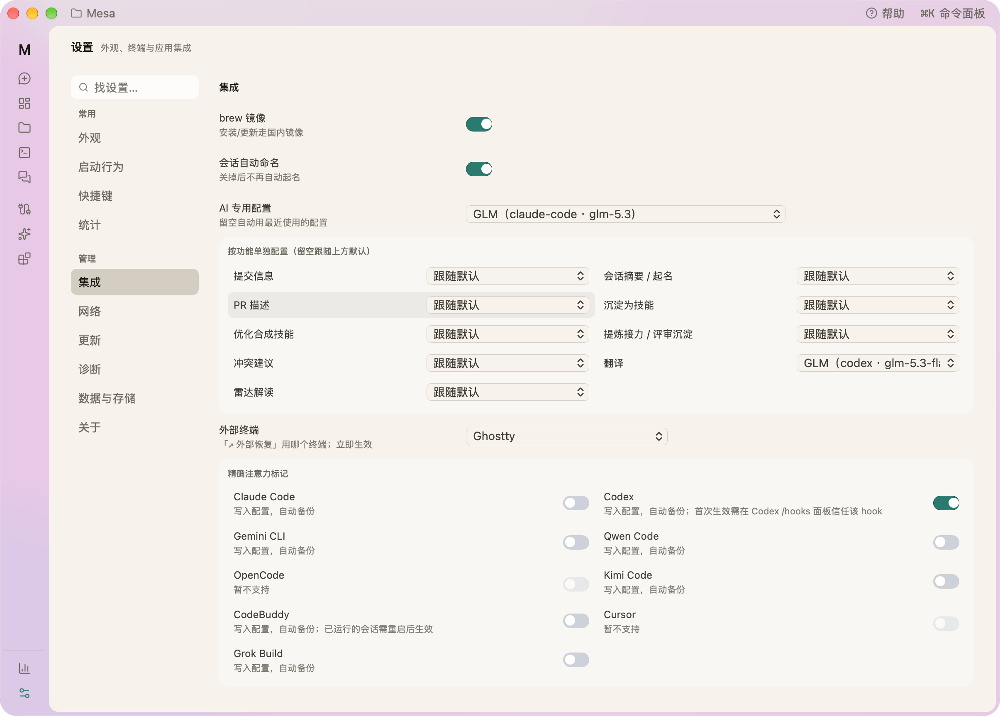

- **设置 → 网络**：出网代理、学校图书馆。

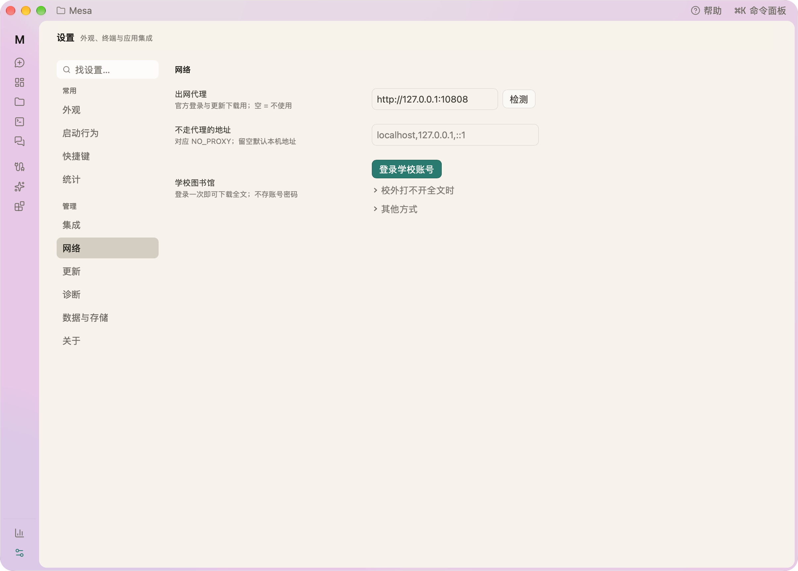

- **设置 → 更新**：下载安装后自动重启，先保存进行中的对话。
- **设置 → 诊断**：环境检查、**导出诊断包**（不含密钥）、生效配置快照。

---

## 14. 常见问题与故障排查

| 现象 | 处理 |
|---|---|
| Mac 提示应用已损坏 | `xattr -cr /Applications/Mesa.app` |
| 按钮没反应 | 找页面中间有没有内联输入框或确认层；仍不行导出诊断包 |
| AI 只说话不建文件、不检索 | 模型不支持工具调用，换一个支持 tools 的 |
| 保存了配置，一运行就 404 | Claude 类地址不带 `/v1`，Codex / Kimi / Qwen 类通常要带 |
| 官方账号 token revoked | 订阅过期，到连接页重新登录；国内配出网代理 |
| 改了模型 `/model` 还是旧的 | 模型是启动时定的：侧栏这段对话 **⋯ → 停下 Agent**，在输入框下面换好模型，再发一句接着聊 |
| 想一次下几十篇付费墙 | 不要，会封学校 IP |
| 步骤工作区里的对话找不到 | 在侧栏所属课题下面（工作副本里的对话也归在课题名下）；或 **搜对话** 按这个项目筛，行上标着步骤名 |
| 改动面板报找不到 git | 诊断页一键安装；Mac 先处理 Xcode 许可弹窗 |
| 做图 / 做视频的对话发着发着报 413 Request body too large | 截图把每次发送的请求体撑过了网关上限。回放顶部点 **瘦身…**（或 ⋯ → **瘦身会话…**），把较早的截图换成文字占位，见说明书 7.2 |

如果您有其他问题与想法提到 [GitHub Issues](https://github.com/hongtongzhou-design/ccode/issues)。最好是附上 **设置 → 诊断** 导出的日志。谢谢！
